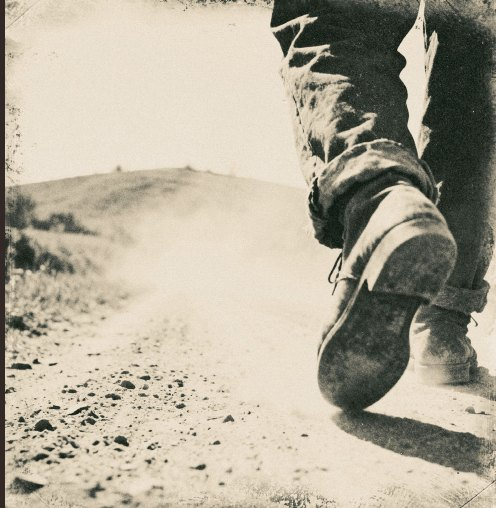

## Акт I: Изобилие

Сыщики прибывают в Либерти-Корнерс. Они знакомятся с горожанами, осматривают город и присоединяются к общей трапезе у церкви.

### Сцена 1. Прибытие в Либерти-Корнерс

Сыщики бредут по грунтовой дороге сквозь жару и пыль Техасского выступа. Больше суток им не встречалось ни одного городка. Они устали, изнывают от жажды и совсем пали духом.

Чуть за полдень они поднимаются на невысокий холм и сквозь пыльную дымку видят городок, окружённый тучными полями и зелёными плодовыми деревьями. Дома опрятно выкрашены, в воздухе звенит детский смех, и нигде нет той вездесущей пыли, которой занесло всю округу. Словно сон наяву.

На въезде сыщики проходят мимо деревянной вывески, вырезанной с любовью: «Добро пожаловать в Либерти-Корнерс». Число жителей закрашивали не раз; теперь на вывеске стоит 75. Улиц как таковых нет, но ровные ряды домов и лавочек тянутся к простой белой деревянной церкви. Перед Бакалеей Эймоса трое упитанных ребятишек играют в серсо. Завидев чужаков, они останавливаются и глазеют на них. Если подойти, дети простодушно скажут, до чего у гостей грязная одежда и какой у них измождённый вид. За едой они советуют обратиться к «мистеру Эймосу» в лавке за их спинами.

В Бакалее Эймоса полно муки, бобов и консервов. Сыщики могут заметить, что свежих фруктов, овощей, мяса и молочных продуктов нет. Эймос Райт встречает их и сразу тревожится, глядя, как они выглядят. Он предлагает им хлеба и тушёных бобов, которые принёс себе на обед. Обещает работу и помощь с ночлегом, а может, и ванну. Даже не заперев лавку, он ведёт их через дорогу к себе домой, чтобы они могли устроиться.

**Улики**

- Пожав Эймосу руку, сыщики заметят, что у него нет безымянного пальца.
- Если спросить о лавке, Эймос скажет, что, собственно, ничего не продаёт: «В Либерти-Корнерс деньги нам ни к чему. Чем можем — делимся, а чего не хватает — вымениваем».
- Техасское солнце палит здесь не слабее, чем везде, но пыли в городке нет. По всему видно, что ни одна пыльная буря сюда вообще не доходила.

### Сцена 2. Знакомство с горожанами

В Доме Райтов чисто и прибрано. Эймос знакомит сыщиков с женой Лиззи Райт и их маленькой дочкой Джейн Райт. Лиззи тепло их приветствует и предлагает одному из гостей свободную комнату «и ванну, если хотите», а заодно немного работы на утро. Она извиняется, что не может принять всех сразу, но уверена, что каждый найдёт ночлег «и дело на завтра». Лиззи и Эймос спрашивают, какую работу сыщики любят или умеют делать, и советуют, к кому обратиться. Эймос также предлагает показать им город. Для готовых сыщиков подойдут следующие сцены:

- Джейми Поттера ведут в Пасторский дом к пастору Клеггу поговорить о помощи с архивом. Пастор в восторге, что кто-то хочет описать историю города, и обещает на следующий день предоставить Джейми свой кабинет в полное распоряжение: сегодня вечером ему ещё готовить проповедь. Остаться у пастора нельзя, но его соседка Сьюзан Эллиотт предлагает Джейми ночлег.
- Джина Вагнера ведут на Ферму Лазарусов. Там Джина радушно встречают жена Билли и трое маленьких детей. Ребятишки сразу привязываются к гостю, ходят за ним по пятам, без конца задают вопросы и стараются «помогать». Лазарусы предлагают постель на чердаке: завтра им пригодится помощь с урожаем.
