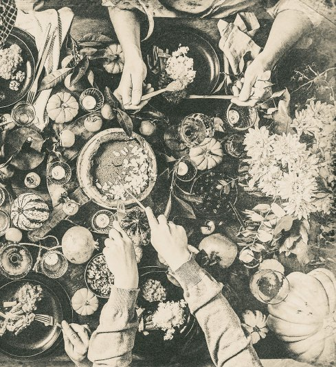

- Робину Сойеру предлагают остановиться у Эймоса и Лиззи в обмен на помощь с готовкой и пополнением запасов в лавке. У Робина будет своя комнатка; здесь уважают и его самого, и его право побыть наедине.
- Сэма Форда знакомят с кузнецом Джимми Бейкером. Джимми расспрашивает о прежней работе и умениях Сэма и предлагает честный, постоянный заработок, где пригодится фабричный опыт.

Где бы ни остановились сыщики, хозяева просят их сегодня больше не думать о труде: «Завтра времени хватит. Сперва отдохните да поешьте досыта».

**Улики**

- Трудная проверка **Внимания** позволяет заметить, что у Лиззи нет левого уха. Если спросить, она краснеет и со смехом отмахивается: «Да это пустяк, особенно если подумать, через что вам пришлось пройти».
- Проверка **Первой помощи** подскажет, что пастор Клегг выглядит малокровным и за показной бодростью скрывает глубокую усталость.
- У Билли Лазаруса почти нет зубов, хотя до старости ему ещё далеко.
- У Сьюзан Эллиотт нет левой кисти.
- Джимми Бейкер носит повязку на месте правого глаза.
- На Ферме Лазарусов есть и небольшой плодовый сад, и кукурузные поля. Странно видеть их так близко: им нужна разная почва.
- На шпиле церкви нет креста. На простой деревянной вывеске снаружи написано: «Наша Мать Священной Земли». Проверка **ИНТ** или **Оккультизма** подскажет, что ни одну христианскую святую или иную фигуру так не называют. *Прим. перев.:* на с. 154 и в раздатке на с. 164 церковь названа Владычицей Зеленеющей Земли.

### Сцена 3. Общая трапеза

Когда сыщики успевают познакомиться с хозяевами, устроиться и привести себя в порядок, по всему городу звенят колокольчики. Звон не церковный: горожане одновременно звонят каждый в свой колокольчик. Так начинается общий ужин. Все собираются перед церковью, где уже расставлены длинные столы и скамьи. Столы ломятся от еды, и вся она растительная. Такого изобилия сыщики не видели много лет, если вообще когда-нибудь видели. Собрался весь город: люди смеются, болтают и веселятся. Они здороваются с сыщиками, перекидываются с ними парой слов и приветствуют их в городе.

Появляется широко улыбающийся пастор Сайлас Клегг. Он приветствует всех, не забывая новоприбывших, и напоминает, что завтра вечером в церкви состоится Благословение урожая. Наконец он читает молитву над едой. В молитве с ответами (раздатка 1: молитва) он обращается к «Благословенной Матери нашей» и благодарит её за дары и щедрость к городу. В конце говорит: «Да приумножатся благословения твои, покуда мы служим тебе и твоей священной земле!» — и от души восклицает: «Йа!» Сыщиков приглашают отвечать вместе со всеми. *Прим. перев.:* в самой раздатке на с. 164 такой концовки нет.

**Улики**

- Если сыщики приглядятся и пройдут проверку **Внимания**, они заметят, что у каждого за столом, кому больше 18 лет, либо чего-то не хватает (пальцев, зубов, а то и целой конечности), либо есть другие признаки нездоровья, например малокровие или желтуха.
- Среди фруктов, овощей и злаков есть и привычные, и диковинные. Некоторых никто из сыщиков в жизни не видал — например гранатов и карамболы. Краски так ярки, что при вечерних свечах плоды словно светятся. Успешная проверка **Искусства/ремесла (земледелие)** или **Науки (биология)** показывает, что для большей части урожая сейчас не сезон и его здесь быть не должно. Трудный успех вдобавок обнаруживает, что многие из этих растений и вовсе не могут расти в этой части Техаса.
- Если спросить, бывали ли в Либерти-Корнерс другие приезжие, горожане ответят примерно так: «Нет у нас в Либерти-Корнерс гостей. Есть только новые родные».

