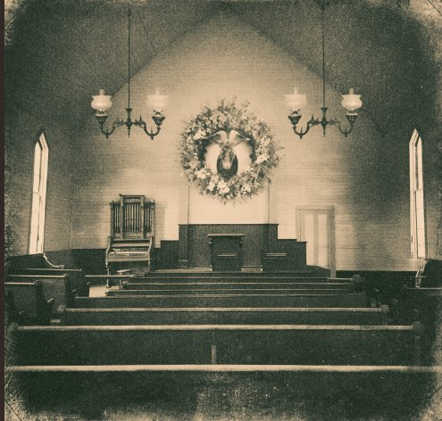

## Акт III: Господство

Акт III завершает первый полный день сыщиков в Либерти-Корнерс. Их приглашают на Благословение урожая. Они узнают правду о городе и решат, принять ли новую жизнь или бежать.

### Сцена. Исступление: Благословение урожая

После рабочего дня сыщиков приглашают в церковь послушать проповедь пастора Клегга и принять участие в Благословении урожая. *Прим. перев.:* здесь в оригинале «отец Клегг», а не «пастор». По пути в церковь сыщики могут собраться вместе, обменяться находками и обсудить, что их тревожит. Если они попытаются уйти, горожане мягко направят их к церкви: нельзя же уезжать без благословения Матери.

Внутри церковь непритязательна. На стене ни креста, ни изображения Христа. Вместо них — венок из свежих цветов, а в его середине висит огромная козлиная голова. Если приглядеться, кажется, что это чучело, но глаз на нём без счёта.

Венок висит над простой кафедрой на возвышении. Перед кафедрой стоит низкий стол, на нём кувшин, деревянная чаша, корзина и свежесобранные фрукты и овощи.

Когда сыщики приходят, в церковь уже стекается весь город. Жители болтают, обмениваются сплетнями. В воздухе чувствуется возбуждение. Когда пастор Клегг поднимается на кафедру, все смолкают. На нём белое облачение с зелёной вышивкой в виде плюща. Он раскрывает Книгу в чёрном кожаном переплёте, больше Библии, и кладёт её на кафедру. С улыбкой он приветствует всех, «и наших новых друзей тоже», на Благословении урожая: «Сегодня Мать вновь одарит нас благословениями, а мы в ответ благословим её нашими жертвами». Он запевает вместе с паствой гимн «Все создания, большие и малые», только вместо Господа Бога везде поют «наша Мать». Все уговаривают сыщиков подпевать. Поют они или нет, боль в животе всё нарастает. Чтобы не упасть от боли, нужна проверка **ВЫН**.

После гимна пастор Клегг рассказывает с кафедры историю Либерти-Корнерс. Напоминает, как город накрыли пыль и отчаяние, которые рассеялись лишь благодаря дарам и благословениям Матери. Он обличает воротил и банкиров, которые «царят над осквернённой, мёртвой землёй», и клеймит тех, кто ничем не жертвует, а ждёт богатства взамен. Он говорит о горе и потерях «простых людей, которые лишились работы, семьи и любви ближних». Проповедь звучит всё неистовее, пока пастор не призывает горожан «принести жертвы, без которых не обойтись, как Мать жертвует собой ради нас, чтобы уберечь этот рай от ада за порогом».

К концу проповеди прихожане стонут от религиозного восторга. Вайолет Лазарус, дочь Билли, бросается вперёд с криком: «Возьми у меня, Мать, чтобы все могли служить тебе и получать твои благословения!» Она выхватывает нож из рога изобилия, растопыривает пальцы на столе перед кафедрой и отсекает три пальца правой руки. Падая, она сияет от блаженства (потеря **Рассудка** 1/1d4). Врач подбегает к ней, перевязывает руку и уводит прочь. Если сыщики не вмешаются, за ней выйдут и другие: одни отдадут кровь, другие вырвут зубы или отрубят часть тела.

> **Заметка Хранителю.** Если кто-то из сыщиков попытается бежать во время этой сцены, за ним увяжется знакомый прихожанин. Он будет умолять остаться и напоминать, что за городом, в пустоши, сыщика ничто не ждёт.

Когда несколько прихожан принесут жертвы, пастор Клегг вновь поднимется на кафедру и позовёт сыщиков к себе: «Теперь ваша очередь, новые наши друзья. Поблагодарите Мать за её щедрость и принесите жертву. Тогда мы примем вас в семью, и вы навсегда останетесь в раю, который мы построили. Выбор за вами. Если жертвовать не хотите — вольны уйти, хоть это и разобьёт нам сердце». Все вокруг ободряют сыщиков, говорят, как их ценят и любят, и уговаривают остаться.
