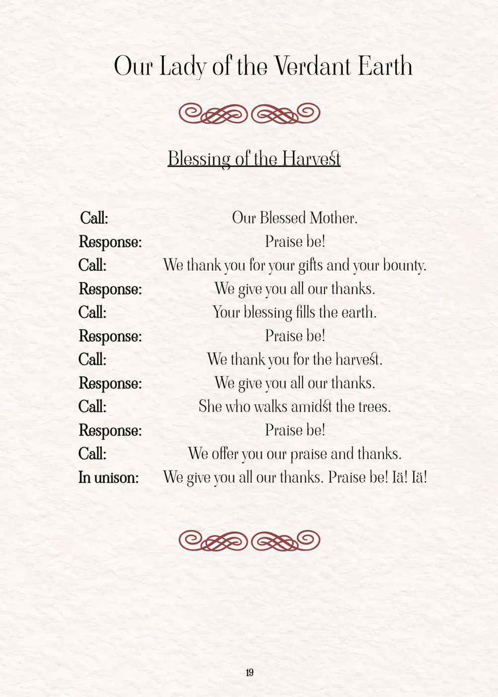

## Раздатки для игроков

> **Раздатка 1. Молитва**
>
> Владычица Зеленеющей Земли  
> Благословение урожая  
> Ведущий: Благословенная Мать наша.  
> Ответ: Хвала ей!  
> Ведущий: Благодарим тебя за дары твои и щедрость твою.  
> Ответ: Возносим тебе всю нашу благодарность.  
> Ведущий: Благодать твоя наполняет землю.  
> Ответ: Хвала ей!  
> Ведущий: Благодарим тебя за урожай.  
> Ответ: Возносим тебе всю нашу благодарность.  
> Ведущий: Та, что ходит среди деревьев.  
> Ответ: Хвала ей!  
> Ведущий: Возносим тебе хвалу и благодарность.  
> Все вместе: Возносим тебе всю нашу благодарность. Хвала ей! Йа! Йа!
