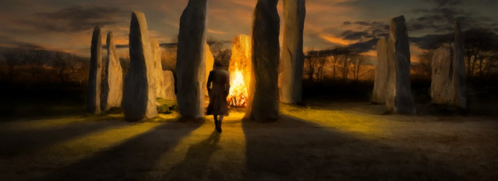

# Нос Галан Гайав. Канун зимы

Сценарий «Зова Ктулху» эпохи газового света. Автор: Лидия Малингс (Lydia Malings).

**Сыщицы:** 4 • **Время игры:** 6 часов

## Вступление

Есть древний обычай: юношу, подающего большие надежды, выбирают в женихи богине. Его свадьба оборачивается похоронами, и его смерть дарует новую жизнь земле и людям. Одна община Южного Уэльса сохранила этот тёмный обычай и превратила его в ещё более жуткий обряд. Поклонники Шуб-Ниггурат приносят жертву не ради богатого урожая или доброй погоды: благодаря ей деревенские покойники оживают на одну ночь.

«Нос Галан Гайав. Канун зимы» — сценарий в жанре фолк-хоррора, вдохновлённый валлийскими легендами и поверьями о Хэллоуине, когда, говорят, завеса между живыми и мёртвыми тоньше всего.

### Структура сценария

Сценарий состоит из пяти частей и занимает около суток игрового времени. В первой части сыщицы вместе со всей деревней празднуют Канун зимы. Игроки могут раскрыть характеры своих сыщиц и их отношения с ключевым персонажем Хранителя — молодым, состоятельным и красивым Томосом Эндрюсом. После праздника по дороге домой они становятся свидетелями жестокого нападения на человека, которого любят в деревне. На следующее утро Томос исчезает, и подозрение падает на сыщиц.

Во второй части сыщицы ищут улики, которые помогут понять, куда пропал Томос. Тем временем жуткая сущность по имени Шуб-Ниггурат даёт своим почитателям знать о себе.

В третьей части выясняется, что деревня задумала принести Томоса в жертву. На помощь приходит местный пьяница, которого мучит совесть: он наконец нашёл в себе силы предать культ. В часовне сыщицы могут воспользоваться тайным ключом, найти улики заговора и получить возможность его сорвать. Поняв, что всё это время жили в самом сердце культа, они встают лицом к лицу с близкими и решают, на чьей они стороне.

В четвёртой части сыщицы добираются до места, где Томоса собираются принести в жертву. Развязка зависит от того, сумеют ли они прервать обряд, сбегут, погибнут или лишатся рассудка.

Пятая, последняя часть — эпилог: мы узнаём, что стало с выжившими сыщицами год спустя. Для особенно коварных Хранителей предусмотрен необязательный поворот — ещё один, последний ужас.
