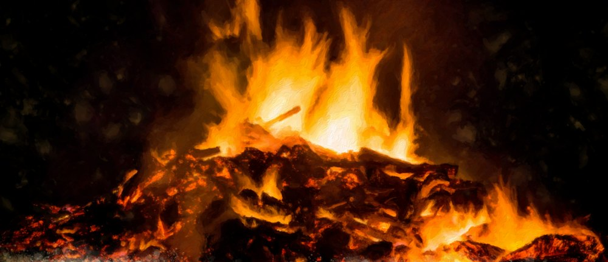

## Предыстория

В этой версии истории в Долинах Южного Уэльса веками жили поклонники Шуб-Ниггурат. Чёрной Козы Чащоб с Тысячью Младых валлийские почитатели знают как Лади Вен. Эта безголовая дама в белом является на перекрёстках и у перелазов в ночь на Хэллоуин. В Уэльсе этот праздник называют «Нос Галан Гайав», то есть «Канун зимы». Лади Вен сопровождает Хух Ди Гута — чудовище, которое, говорят, пожирает непослушных детей, загулявшихся допоздна.

Каждый год старейшины культа изучают небеса, чтобы узнать, какой жертвы ждёт богиня. Обычно в каменном круге за деревней закалывают скот. Но теперь, на пороге нового века, было решено, что нужна человеческая жертва.

Осенью 1899 года старейшины избрали красавца Томоса Эндрюса: ему выпала сомнительная честь стать разом и женихом Лади Вен, и блюдом на её свадебном пиру. Старейшины верят, что, получив возлюбленного, богиня наградит деревню: всем, кто умер за последний год, она позволит на одну ночь вернуться к родным.

Сыщицы — молодые женщины, каждая по-своему близка с Томосом. Они и не подозревают, что их друзья и близкие тайно состоят в культе. Когда Томос исчезает, они отправляются на поиски, не догадываясь, чем это может обернуться для всей деревни.

### Валлийский фольклор

Сценарий во многом опирается на валлийские поверья о Хэллоуине, хотя поклонники Шуб-Ниггурат переосмыслили и извратили показанные здесь праздники и обычаи.

Настоящий Нос Галан Гайав — традиционный валлийский праздник урожая и наступления зимы. В старину вся община собиралась у костра, устраивала пир и забивала скот, чтобы запасти мясо на зиму. Считалось, что в эту ночь, как и в нынешний Хэллоуин, по земле бродят призраки. Любили гадать, чаще всего о том, кому в новом году жениться, а кому умирать. Одно из таких гаданий появится в первой сцене.

Лади Вен и Хух Ди Гута восходят к настоящим валлийским поверьям. Это опасные духи, которые, говорят, бродят в ночи накануне зимы. Старинный стишок велит детям не гулять допоздна: кто последним останется на улице, того духи поймают и съедят.

> Hwch Ddu Gwta a Ladi Wen heb ddim pen  
> Hwch Ddu Gwta a gipio’r ola’  
> Hwch Ddu Gwta nos G’langaea  
> Lladron yn dwad tan weu sana.

> Чёрная свинья и безголовая леди в белом  
> Последнего поймают, кто с улицы не ушёл.  
> Воры кругом, чулки вяжут,  
> В Канун зимы берегись бесхвостой чёрной свиньи.

В этом сценарии оба духа — воплощения Шуб-Ниггурат. Лади Вен, как правило, сама не вмешивается: ей поклоняются культисты. Более проворная Хух Ди Гута является, когда нужно действовать силой. Они могут явиться вместе и действовать как одно существо.
