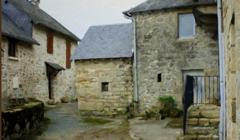

## Действующие лица

### Томос Эндрюс, 19 лет
*Местный юноша*

Томос — сын сравнительно состоятельной семьи. Его характер, прошлое и отношения с сыщицами сложатся в ходе игры.

**Черты:** Обаятелен, любим в деревне.

**Подсказки для отыгрыша:** За обаянием скрывается тоска. Томос чувствует, что мать никогда не оправится после смерти мужа и что муж значил для неё куда больше, чем сын. Томос не знает, что его выбрали в жертву Шуб-Ниггурат.

### Родри Тревор, 50 лет
*Раскаявшийся пьяница*

Прежде историк, втайне культист, Родри пьёт, чтобы заглушить стыд, вину и страх. Из культа он ещё не ушёл, но грядущее жертвоприношение Томоса терзает его.

**Черты:** Виноватый, несчастный.

**Подсказки для отыгрыша:** У него не хватает духу порвать с односельчанами. В сыщицах он видит шанс искупить вину, пусть даже ценой жизни. *Прим. перев.:* в статблоке на с. 180 он назван «раскаявшимся культистом».

### Ангарад Эндрюс, 43 года
*Культистка*

Миссис Эндрюс всегда в чёрном, с вдовьей вуалью. Под давлением культа и в надежде вновь увидеть покойного мужа она согласилась отдать сына Томоса в жертву Шуб-Ниггурат.

**Черты:** Глубоко переживает всё, доведена до отчаяния.

**Подсказки для отыгрыша:** Решение принести в жертву Томоса разрывает её надвое. Она любит сына, но культ и покойного мужа любит сильнее. Она убедила себя, что Томос уйдёт в лучший мир.

### Катрин Морган, 55 лет
*Предводительница культа*

Миссис Морган — жена местного врача и, на первый взгляд, опора общины. Тайно она возглавляет культ, и именно ей предстоит провести жертвоприношение.

**Черты:** Хладнокровна, почтенна, непреклонна, держится приличий.

**Подсказки для отыгрыша:** На вид спокойная и практичная; внутри — ни чувств, ни тепла. Человеческую жертву принесёт не моргнув глазом.

### Преподобный Гетин Пулл, 68 лет
*Старший культист*

Выдаёт себя за священника деревенской часовни, а на деле — второй человек в культе Шуб-Ниггурат.

**Черты:** На людях добродушен, приятен и отзывчив, но за этой личиной — безжалостный обманщик, готовый и убить, и умереть за свою настоящую веру.

**Подсказки для отыгрыша:** Втирается к сыщицам в доверие, чтобы, когда после его смерти откроется предательство, удар оказался ещё больнее.

## Место действия

Лланвенкойд — маленькая деревня в Долинах Южного Уэльса. У других деревень леса вырубили для медных и железных заводов, а Лланвенкойд по-прежнему укрыт лиственным лесом. В пору промышленной революции жизнь в Южном Уэльсе нелегка, но здешние жители держатся друг друга и гордятся своей деревней.

Большинство живёт в тесных рядах примыкающих друг к другу домов из серого камня. Немногие просторные отдельно стоящие дома принадлежат семьям побогаче, таким как Эндрюсы и Морганы.

На окраине деревни — древнее кладбище. Оно существует с дохристианских времён и до сих пор служит по назначению. Сразу за ним находится столь же древний каменный круг, где каждый год проходит эйстедвод — праздник валлийской литературы и музыки.

В центре Лланвенкойда есть славный деревенский луг, школа в одну комнату, пекарня, зеленщик, лавка товаров, мануфактурная лавка, паб и Рабочий институт Лланвенкойда («Стьют»). Как и в других подобных селениях той поры, жизнь общины сосредоточена вокруг часовни. В Уэльсе XIX века сильна традиция нонконформизма — протестантских течений, не подчиняющихся Церкви Англии, — и Лланвенкойд не исключение. Вот только на самом деле в часовне поклоняются Шуб-Ниггурат, прикрываясь благопристойным валлийским методизмом.
