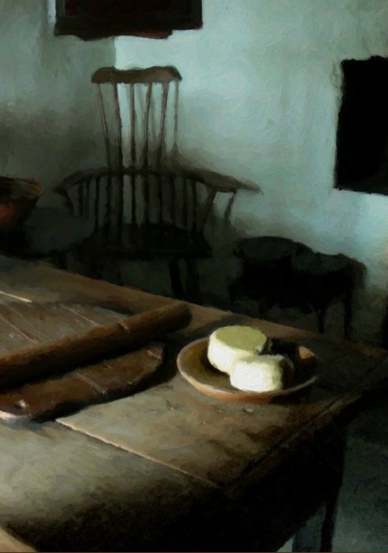

## Часть II. Пропавший юноша

Сыщицы видят, как нападение на преподобного Пулла изменило отношение к ним, а мать Томоса поднимает тревогу из-за его исчезновения. Между тем в деревне зреет страх, что кто-то помешал предстоящему обряду пробуждения мёртвых.

### Судьба преподобного Пулла

На следующее утро сыщицы приходят проведать преподобного в Дом Морганов. Он мёртв, его готовят к погребению.

Лицо Катрин Морган непроницаемо. Если в последний раз сыщицы видели Пулла живым, она объясняет, что он умер ночью от ран. Сыщицы, возможно, рассчитывали, что их встретят как героинь, но Катрин благодарит их лишь из вежливости. По её словам, на Пулла напала одичавшая собака. Ещё одна проверка **Психологии** подсказывает, что Катрин знает о нападении больше, чем говорит, и объяснение её лживо. На самом деле накануне, едва сыщицы ушли, она задушила священника подушкой.

Сельчане, пришедшие проститься с покойным, тоже держатся настороженно, совсем не так приветливо, как обычно. Они рассчитывали, что Пулл погибнет при нападении: это необходимая часть жертвоприношения Томоса Лади Вен. На каждой свадьбе нужен священник, а культисты верят, что преподобный должен провести часть обряда с той стороны завесы, пока миссис Морган руководит им в мире живых. Если сыщицы спасли Пулла, они сами того не зная сорвали эту часть обряда. Даже если он умер от ран накануне, обряд всё равно в опасности: сельчане боятся, что непосвящённые сыщицы раскроют его до завершения.

### Весть об исчезновении

Как только сыщицы успевают заметить, до чего неприветливо их теперь встречают, в комнату врывается мать Томоса, Ангарад Эндрюс (Анг-ХА-рад). Волосы растрепались, чепец сбился набок. «Пропал! — кричит она. — Мой Томос пропал!» За чаем миссис Эндрюс объясняет, что ночью он не вернулся домой и она боится, как бы с ним чего не случилось. От волнения она больше не в силах говорить, и миссис Морган невозмутимо отводит её отдохнуть наверх, в свободную спальню. На самом деле миссис Эндрюс так взволнована потому, что жертвоприношение теперь под угрозой.

Вернувшись, миссис Морган поручает сыщицам найти Томоса. Искать его будут и взрослые жители деревни, но, по мнению миссис Морган, сыщицам может помочь то, что они его хорошо знают. Она мрачно предупреждает: мать и без того чуть не обезумела от горя после смерти мужа, а если сына не найдут, она может совсем сломаться. Похоже, миссис Морган искренне хочет, чтобы Томос нашёлся, хотя причины у неё, конечно, не те, что у сыщиц. Она также намерена приставить к ним наблюдателей.

## Часть III. Поиски

Сыщицы могут отправиться на поиски пропавшего Томоса. Тем временем странные происшествия в деревне выдают нетерпение Лади Вен, которая ждёт обряда. Если нужно ускорить эту часть игры, Хранитель может направить сыщиц в часовню или к Родри Тревору. Если игроки сами не разыщут Родри или не найдут улик, чтобы понять, куда делся Томос, пусть Родри сам найдёт сыщиц.

### Дом Эндрюсов

Сыщицы могут зайти к Томосу домой, но служанка миссис Эндрюс неохотно пускает гостей в отсутствие хозяйки. Чтобы войти, нужна успешная проверка навыка общения, например **Обаяния** или **Убеждения**. Можно также пробраться через чёрный ход или залезть в окно, применив **Скрытность** либо другой подходящий навык.
