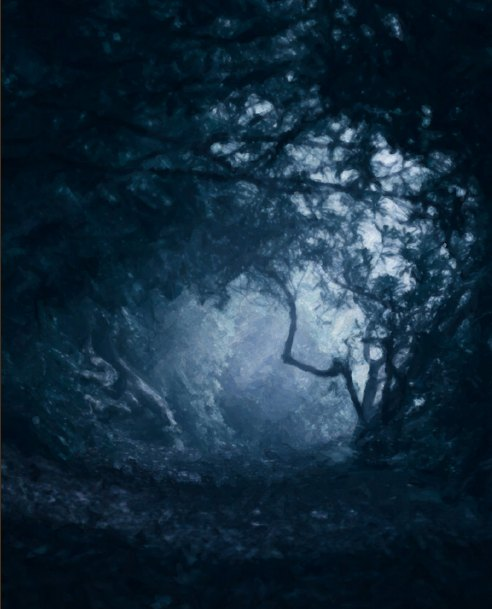

### Лес и пещера

Сыщицы могут отправиться в лес за Томосом. Лес на склоне долины густой, тёмный, давящий. Чтобы пойти по следам Томоса, нужна успешная проверка **Чтения следов**, и пройти её можно, только начав от места находки перочинного ножа на тропе от каменного круга. Если сыщицы говорили с Родри, он мог объяснить им, как добраться до Пещеры Томоса, где юноша укрылся. Даже без этих подсказок или при провале проверки сыщицы найдут Томоса, но их блуждания привлекут внимание Хух Ди Гута. Они слышат странный топот, иногда краем глаза улавливают какое-то движение. Они отчётливо чувствуют, что за ними наблюдают, и проходят проверку **Рассудка** (потеря 0/1).

Томос и рад видеть сыщиц, и тревожится за них. Встречу прерывает появление дюжины вооружённых сельчан: они окружают вход в пещеру. Поначалу сыщицы могут надеяться, что те пришли помочь. Среди сельчан их друзья и родные, в том числе значимые люди с листов персонажей. Но надежда тает, когда сельчане — на самом деле члены культа — требуют выдать Томоса.

Большинство культистов вооружены ножами. У двоих дробовики, так что сопротивляться неразумно и долго это вряд ли продлится. Сыщицы могут попытаться убежать, но, скорее всего, их остановят или поймают позже.

Понять, что родные и друзья на самом деле состоят в культе и хотят принести близкого человека в жертву, — тяжёлый удар. Хранитель может напомнить сыщицам их прошлое и показать, как открывшаяся правда меняет воспоминания. Например, Марджери вспоминает ссору родителей. Её мать-ямайка сказала об отце, что тот «наложил козий рот» на товарища по команде, с которым повздорил. Обычно так говорят, когда желают кому-то зла, но теперь Марджери думает: а вдруг за этими словами стояло нечто большее? Гвенно вспоминает мамину колыбельную: может, это был не старый средневековый валлийский говор, а гимн тёмной богине? Элен вдруг вспоминает, что дедушка к воскресному костюму надевал блестящий латунный брелок для часов с выгравированным козлом. Только у Кэтрин, выросшей не здесь, нет воспоминаний, которые могли бы померкнуть.

Когда сыщицы требуют объяснений, культисты говорят с ними рассудительно, тепло и почти с печалью. Они с распростёртыми объятиями зовут сыщиц вступить в культ и стараются ответить на все вопросы.

- Культисты твердят, что не хотят причинять сыщицам вред, если только их не вынудят.
- Они намерены привести сыщиц на последний обряд, чтобы те увидели его своими глазами, но обещают после отпустить.
- Они пытаются убедить сыщиц, что жертва необходима, и говорят о круговороте жизни и смерти, любви к семье, верности и узах общины.
- Культисты не знают, где и когда зародился Культ Лади Вен: древние кельты не оставили записей. Но они верят, что их обычаям бессчётно много веков.
- Если преподобный Пулл был ещё жив, когда сыщицы ушли из дома врача, миссис Морган скажет, что задушила его подушкой сразу после их ухода. Он умер спокойно. Она объясняет, что без его смерти обряд не мог удаться.
- Если сыщицы уже уничтожили обрядовые предметы из часовни, культисты огорчатся, но намерены обойтись тем, что есть. Если предметы всё ещё у сыщиц, культисты потребуют их вернуть и, если понадобится, отнимут силой.

Некоторые сыщицы могут подыграть культистам в расчёте потом их предать и освободить Томоса, а заодно и тех, кто продолжает сопротивляться. Других, если они потеряли достаточно Рассудка, может всерьёз прельстить обещание крепкой общины и верности семье. Тем, кто не согласился вступить в культ, свяжут руки. Затем их вместе с Томосом уведут в деревню.
