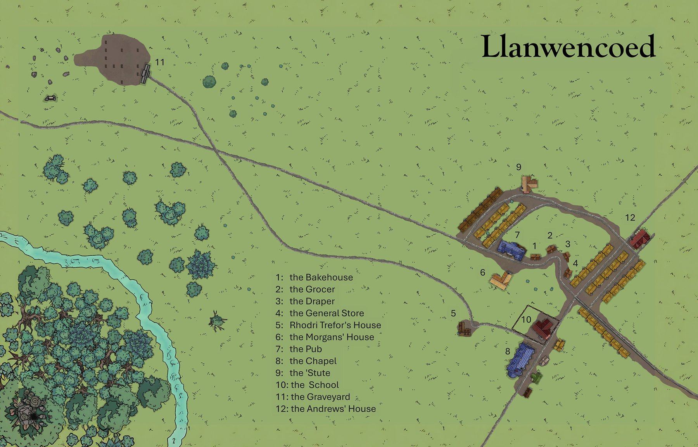

## Раздатки для игроков

> **Раздатка 1. Карта Лланвенкойда**
>
> 1. Пекарня.
> 2. Зеленщик.
> 3. Мануфактурная лавка.
> 4. Лавка товаров.
> 5. Дом Родри Тревора.
> 6. Дом Морганов.
> 7. Паб.
> 8. Часовня Лланвенкойда.
> 9. Рабочий институт Лланвенкойда («Стьют»).
> 10. Школа.
> 11. Кладбище Лланвенкойда.
> 12. Дом Эндрюсов.
