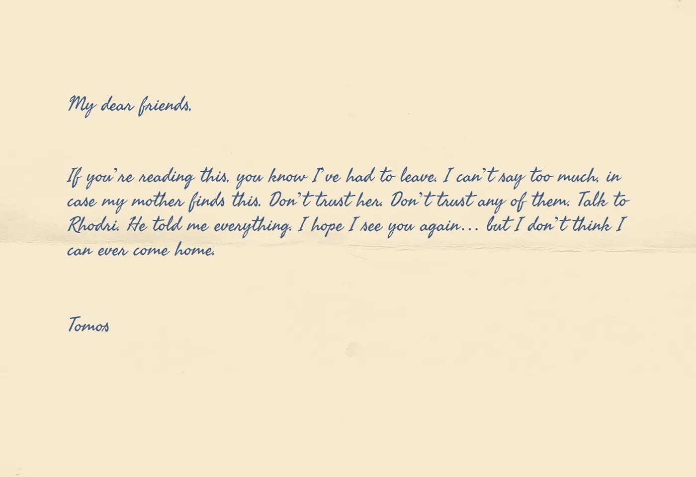

> **Раздатка 2. Записка Томоса**
>
> Мои дорогие друзья,  
> Если вы это читаете, значит, вы знаете, что мне пришлось уйти. Многого сказать не могу — вдруг мама найдёт. Не доверяйте ей. Не доверяйте никому из них. Поговорите с Родри. Он мне всё рассказал. Надеюсь, мы ещё увидимся… но, думаю, домой мне уже не вернуться.  
> Томос
