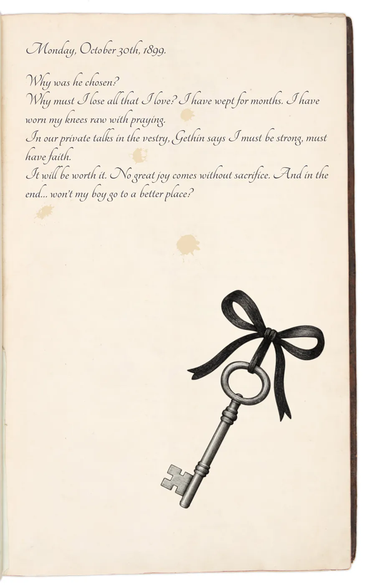

> **Раздатка 3. Дневник миссис Эндрюс**
>
> Понедельник, 30 октября 1899 г.  
> Почему выбрали его?  
> Почему я должна потерять всё, что люблю? Я плачу уже много месяцев. Я стёрла колени в кровь молитвами.  
> В наших личных беседах в ризнице Гетин говорит, что я должна быть сильной, должна верить.  
> Это того стоит. Великой радости не бывает без жертвы. И в конце концов… разве мой мальчик не уйдёт в лучший мир?
