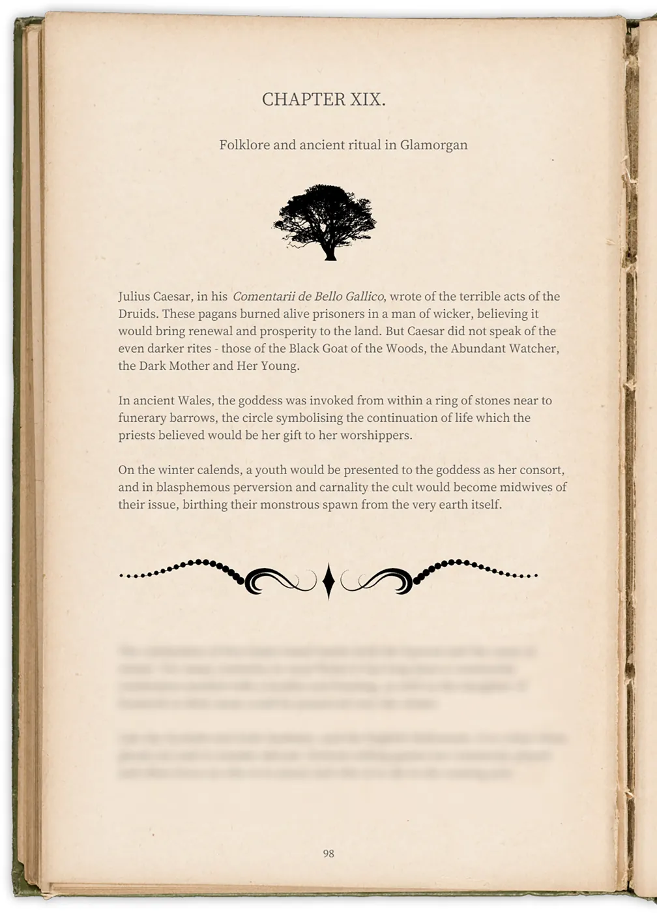

> **Раздатка 4. «Фольклор и древние обряды Гламоргана»**
>
> ГЛАВА XIX.  
> Фольклор и древние обряды Гламоргана  
> Юлий Цезарь в своих «Записках о Галльской войне» писал об ужасных деяниях друидов. Эти язычники сжигали пленников заживо в плетёном человеке, веря, что это принесёт земле обновление и процветание. Но Цезарь ничего не сказал о ещё более тёмных обрядах — обрядах Чёрной Козы Чащоб, Обильного Стража, Тёмной Матери и Её Младых.  
> В древнем Уэльсе богиню призывали из кольца камней близ погребальных курганов; круг символизировал продолжение жизни, которое, как верили жрецы, она дарует своим почитателям.  
> В зимние календы богине представляли юношу как её супруга, и в богохульном извращении и плотском неистовстве культ становился повитухой их потомства, рождая чудовищное отродье из самой земли.  
> [дальше текст размыт и не читается]  
> 98

*Прим. перев.:* на изображении раздатки латинское название «Записок о Галльской войне» напечатано с одной `m`: *Comentarii de Bello Gallico*, а не *Commentarii de Bello Gallico*.
