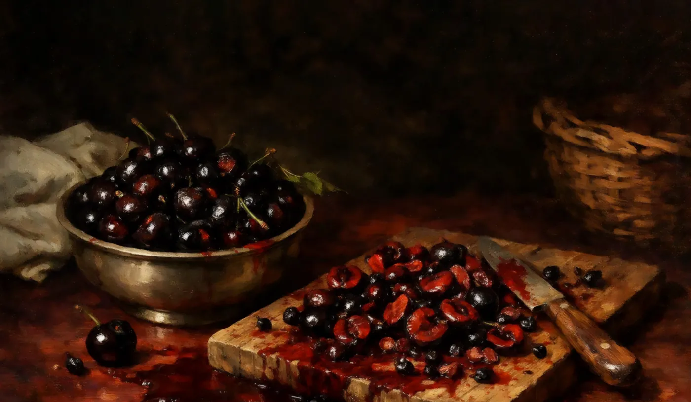

# Невостребованные письма из сада

Классический сценарий для «Зова Ктулху» от Перри Кларка  
**Сыщики:** 2–5 • **Время игры:** 6–8 часов

## Вступление

В 1910 году в чернокожей общине Западного Харперс-Орчарда происходят жуткие убийства и исчезновения. Когда в соседнем Северном Харперс-Орчарде, где живут белые, убивают троих жителей, обстановка накаляется. Теперь открытое столкновение между общинами — лишь вопрос времени. Сыщики должны разгадать загадку, прежде чем жители Северного Харперс-Орчарда сожгут Западный дотла.

### Структура сценария

Сыщики либо сами недавно пережили нападение, либо связаны с кем-то из пропавших. Недавние убийства нескольких жителей Северного Харперс-Орчарда, где преобладают белые, подожгли фитиль. Медлить нельзя.

События сценария укладываются в один игровой день. В начале сыщики собираются в редакции газеты и читают письмо Джона Харпера (**Раздатка 1. Письмо Джона Харпера**). Он опасается, что после убийства трёх белых жителей Северный Харперс-Орчард вот-вот прибегнет к насилию, и просит как можно скорее разобраться в происходящем.

В **акте I** сыщики берутся за те улики, что уже есть у них на руках, в том числе за пустой конверт, и посещают места в городе, связанные с убийствами. Они выясняют, что происшествия случаются только в новых кварталах Западного Харперс-Орчарда, а в Северном ничего подобного нет. Улики ведут и к семье Харперов, в том числе к мэру, который сам позвал сыщиков на помощь. Последней стоит посетить почту: на этом акт I заканчивается.

**Акт II** начинается с нападения почтового служащего. Сыщики успевают сопоставить улики и понять, что все происшествия связаны с письмами на похожем на кору пергаменте. Они узнают и о двух «невостребованных письмах», которые пока не удалось отыскать, и решают, что с ними делать. Они находят новые куски коры и узнают о ритуале и заклинании, позволяющем подчинить Тёмную молодь. По меньшей мере у одного сыщика, прикасавшегося к письму, начинаются заметные превращения.

В **акте III** у сыщиков должно быть достаточно доказательств, чтобы расспросить мэра Джона Харпера и предъявить ему обвинения. Они сталкиваются с силами Мифов в особняке Харперов или в теплице за центром переработки урожая. Им предстоит решить, как спасти город.
