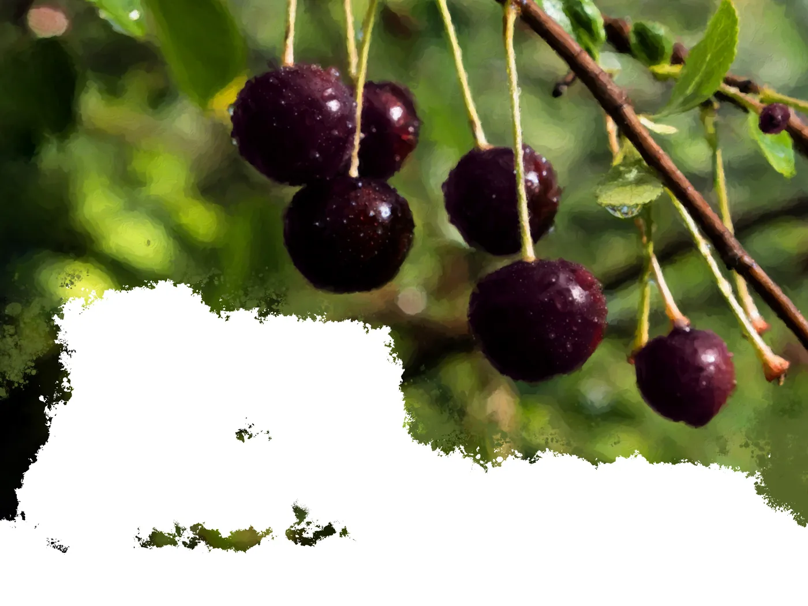

## Предыстория

> **Исторический контекст**
>
> Действие происходит в 1910 году. Сценарий призван показать, с какими трудностями, ограничениями и опасностями сталкивались небелые люди и представители ЛГБТ+. Хранителю стоит учесть следующее:
>
> - Действуют законы Джима Кроу. На бумаге они обещают белым и небелым «раздельные, но равные» условия. На деле это означает огромное неравенство и узаконенную дискриминацию.
> - Северный Харперс-Орчард известен как «закатный город»: небелым опасно оставаться там после захода солнца.
> - Межрасовые отношения строго запрещены законом и осуждаются культурой и обществом.
> - Квирность считается и душевной болезнью, и грехом перед христианским Богом. Если об этом узнают, белому человеку, скорее всего, грозит психиатрическая лечебница, а небелому — смерть, в том числе так называемое «убийство чести».
> - Хотя расовое рабство отменили несколько десятилетий назад, расовая и нравственная неполноценность небелых людей по-прежнему считается чем-то само собой разумеющимся.
>
> Конфликт двух Харперс-Орчардов предвосхищает «Красное лето»: белое большинство принимало за расовое оскорбление даже недоразумения, и целые кварталы и города, в том числе в Талсе (Оклахома) и Роузвуде (Флорида), сравнивали с землёй. В 1910 году многие жили в страхе перед вспышкой ничем не сдерживаемого гнева белых.
>
> *Прим. перев.:* в оригинале назван 1918 год. «Красное лето» пришлось на 1919 год, а расправы в Талсе и Роузвуде — на 1921 и 1923 годы соответственно.
>
> Жёсткие гендерные нормы всё ещё ограничивают участие женщин в общественной жизни, диктуя им, как себя вести и чего от них ждут.

Джон Харпер, белый человек, широко известный своей аболиционистской деятельностью, основал на унаследованной земле Западный Харперс-Орчард — город, где люди разных рас должны были жить на равных.

К несчастью, вместе с землёй Джон унаследовал несколько древних книг, суливших небывалое могущество. Чем больше он читал, тем сильнее расшатывался его рассудок, пока его личность не раскололась надвое. С тех пор Джон-аболиционист продолжал воплощать замысел Западного Харперс-Орчарда, а Джон-верующий набирался сил, изучая древние книги и поклоняясь описанной в них Чёрной Козе Чащоб, Шуб-Ниггурат.

В погоне за могуществом Джон-верующий уже принёс в жертву отца и брата, превратив их в чудовищных древесных слуг Шуб-Ниггурат. Он срезал с них кору: стоит прикоснуться к ней, и она подчиняет и заражает жертву, распространяя влияние Шуб-Ниггурат. К началу сценария Джон-верующий разослал куски коры под видом обычных писем жителям обоих Харперс-Орчардов. Исчезновения и гибель людей обострили отношения между общинами.

Джон-аболиционист не подозревает о своём втором «я», хотя то исподволь им руководит. Пока он пытается удержать жителей Северного Харперс-Орчарда от расправы над городом своей мечты, он просит тех, кому доверяет, разобраться в череде убийств.
