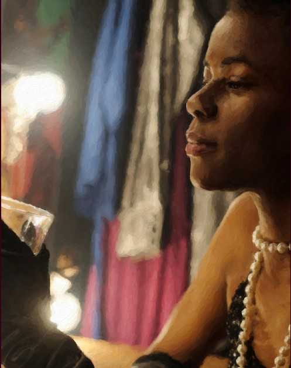

## О сыщиках

Игроки выбирают одного из трёх готовых сыщиков. Для больших групп предусмотрены ещё двое. Тех, кого не выбрали, Хранитель при необходимости может использовать как неигровых персонажей.

> **Приступы безумия**
>
> На протяжении сценария у сыщиков могут случаться приступы безумия. У каждого есть возможная фобия и мания, связанные с характером или прошлым. Хранитель решает, какая из них проявится, исходя из причины временного помешательства.
>
> 1. Лонни: антофобия — страх цветов и растений; дипсомания — болезненная тяга к спиртному.
> 2. Тильда: скотофобия — страх темноты; демономания — болезненная уверенность в одержимости демонами.
> 3. Корал: аутофобия — страх остаться в одиночестве; танатомания — убеждённость, что тебя прокляли смертоносной магией.
> 4. Куин: рабдофобия — страх магии; алгомания — одержимость болью.
> 5. Доктор Санчес: гемофобия — страх крови; эносимания — болезненная уверенность в собственной греховности.
>
> *Прим. перев.:* здесь имя Лонни в оригинале написано «Lonnie», а на листе сыщика — «Lonny».

### Тильда Уислер, 24 года

**Репортёр (она/её)**

Семья Тильды — одна из многих чернокожих семей, которых Джон Харпер принял в Западном Харперс-Орчарде. При его поддержке Тильда заочно изучала журналистику в Мискатоникском университете.

**Черты:** Тильда предана своему брату, ныне пропавшему без вести. Она наблюдательна и замечает мелочи, которые ускользают от других.

**Подсказки к отыгрышу:** брат Тильды, Альберт Уислер, в приступе внезапного безумия напал на их общего друга, сыщика Куина Тумса, и исчез. Тильда во что бы то ни стало хочет узнать, что произошло.

### Куин Тумс, 25 лет

**Помощник шерифа (он/его)**

Когда семья Куина переехала в Западный Харперс-Орчард, Джон Харпер помог ему поступить на заочное отделение Мискатоникского университета, где он изучал полицейское дело. Теперь Куин служит в Западном Харперс-Орчарде и подчиняется шерифу Северного. Его напарник — Альберт Уислер, его лучший друг.

**Черты:** Куин — порядочный человек, которого уважают в городе. На него уже действуют силы Мифов: по ходу сценария его кожа твердеет и всё больше напоминает кору.

**Подсказки к отыгрышу:** Куин был с Альбертом в квартире Гозы, когда тот исчез. Он забрал оттуда загадочный конверт и намерен помочь Тильде выяснить правду.

*Прим. перев.:* на листе сыщика Куину 24 года.

### Корал Бэгс, 24 года

**Исследователь и студент (они/их)**

Семья Корал — тоже одна из многих чернокожих семей, которым Джон Харпер помог обосноваться в Западном Харперс-Орчарде. При его поддержке Корал заочно изучают методы исследования и научное письмо в Мискатоникском университете. В Западном Харперс-Орчарде Корал наконец могут постоянно жить под своим именем, а не под именем Митчел, данным при рождении.

**Черты:** Корал тянутся к знаниям, читают запоем и мечтают целыми днями писать.

**Подсказки к отыгрышу:** после череды исчезновений Корал взялись изучать странные знаки, оставленные на местах преступлений. В книгах из библиотеки Харперов они наткнулись на знания о Мифах, даже не догадываясь, с чем имеют дело.

*Прим. перев.:* на листе сыщика Корал 22 года.
