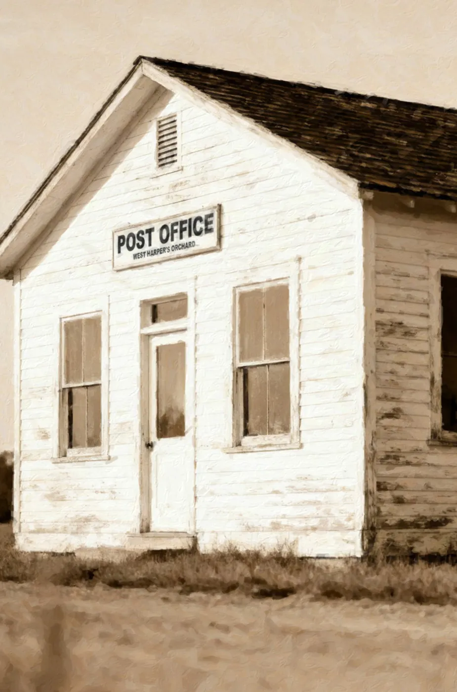

Если с ними Тильда Уислер, это то самое место, где она видела тела и нашла куртку брата. Здесь у неё возникает сильное чувство, что за ней следят. На самом деле поблизости бродит Альберт, который ещё не закончил превращаться. При успешных проверках навыков сыщики находят следующее:

- На кизиле — знаки, обведённые пятнами крови. Кровь теперь почти незаметна. Знаки совпадают с рисунком Тильды; их можно расшифровать успешной проверкой МОЩ (см. **Раздатку 5. Кора**). Те, кто был в пансионе, могут заметить, что там были те же знаки (Оккультизм).
- В кустах валяются окровавленный камень и острая палка со следами крови и плоти. Полиция их проглядела (Внимание).
- Видно, как тела белых рабочих волокли с дороги между Северным Харперс-Орчардом и перерабатывающим цехом (см. **Раздатку 2. Карта Харперс-Орчарда**).
- За последние несколько часов дерево чудовищно разрослось. Об этом может сказать Тильда; это видно и по переломанным веткам и корням соседних деревьев (Естествознание или Искусство/ремесло (плотницкое дело)). Если полить дерево свежей кровью и подождать несколько минут, появляется новый нарост. Чем больше крови, тем заметнее рост.
- Следы неизвестного, на самом деле Альберта, убийцы троих рабочих, уходят в нерасчищенную, на вид непроходимую Чащу (Чтение следов или Внимание).

Если сыщики пойдут к Северному Харперс-Орчарду по тропе или дороге для повозок, они увидят группы вооружённых белых мужчин на страже. Сыщикам должно быть ясно, что подходить ближе крайне опасно.

### Почта Западного Харперс-Орчарда

Почта — деревянное здание, выкрашенное в белое, по виду и размерам похожее на редакцию. Позади маленький двор для повозок и место для погрузки. Из небольшого вестибюля широкая дверь из двух половинок ведёт в подсобку, где стоят два стола для сортировки почты.

На почте заканчивается акт I. Найти сюда дорогу сыщикам поможет конверт невостребованного письма из квартиры Патрика Гозы (**Раздатка 3. Конверт из квартиры Гозы**) или упоминание о пожертвовании почте, услышанное от Уилы Лоренс.

Сыщиков встречает пожилой почтовый служащий Элайас Хьюз: он как раз сортирует почту. Поздоровавшись, он предлагает помочь, чем сможет по службе.

Увидев конверт, Элайас упоминает почтовый журнал. Его можно убедить показать журнал (**Раздатка 4. Почтовый журнал**). Прочитав записи, сыщики могут спросить о двух недоставленных письмах. Если не спросят, Элайас сам о них заговорит. Они пришли в партии писем из Северного Харперс-Орчарда. Два письма из этой партии разнесли вчера; он может показать в журнале, куда их доставили. При успешной проверке Убеждения или другого социального навыка он достанет и оба недоставленных конверта и даст их осмотреть. Можно также упомянуть, что сыщиков прислал Джон Харпер.

Элайас передаёт одно из двух недоставленных писем, а другое удерживает в руке. Конверт надорван. Успешная проверка Внимания показывает, что пальцы Элайаса сжимают выглядывающее из прорехи письмо. Замечают сыщики это или нет, они видят, как его глаза наливаются кровью. Если его не остановить, он хватает со стойки наколку для бумаг и бросается на сыщиков. Если схватка затянется, Элайас убегает; иначе сыщикам придётся убить или как-то обезвредить его.

