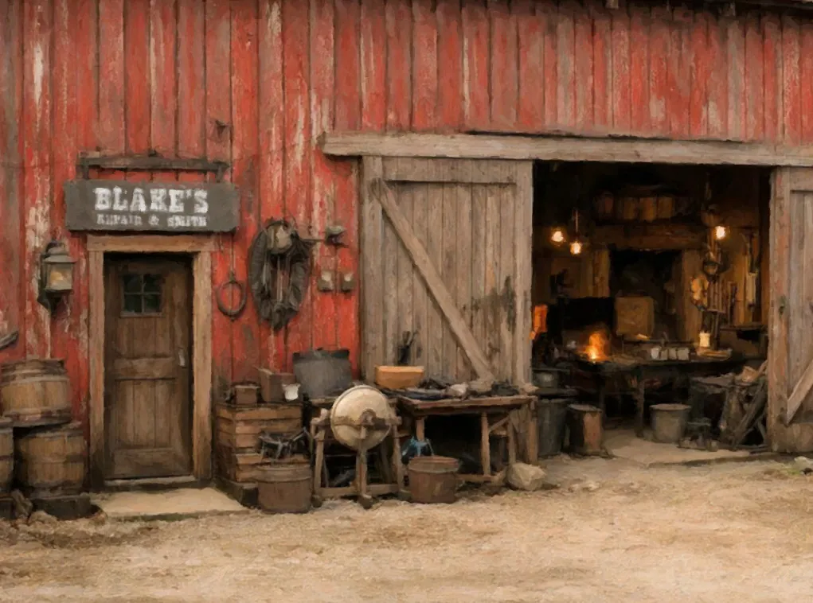
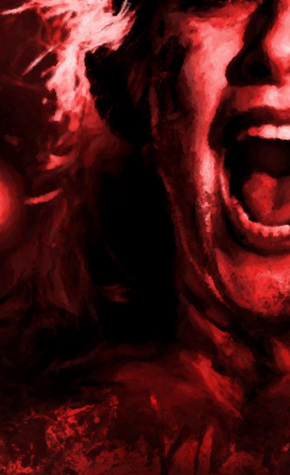

сыщикам. Проверка Психологии показывает, что Полли учащённо дышит в предвкушении и пристально следит, чтобы гости выпили всё. Проверка Внимания позволяет заметить странный осадок на дне каждого стакана.

У любого, кто выпьет хоть немного лимонада, через один раунд начинается сильная рвота и судороги от стрихнина, который подмешала Полли: 1d6 урона в течение 1d3 раундов. Если сыщики поставят стаканы или иным образом покажут, что пить не собираются, Полли нападёт на них с подносом.

Если детей обезвредить, становится ясно, что оба лишились рассудка. Они начинают твердить песнопение с коры, которое привело Гозу к самоубийству. Так устанавливается связь между событиями (см. **Раздатку 5. Кора**).

### «Ремонт и кузница Блейка»

> Большой одноэтажный сарай выкрашен красным. Перед ним есть место для автомобилей. С одной стороны широкие ворота для повозок и материалов, с другой — дверь в маленькую контору. На стене чёрная вывеска с белыми буквами: «Ремонт и кузница Блейка».

Входная дверь распахнута настежь. За стойкой никого, но из глубины здания, со стороны мастерской и кузнечного горна, доносятся звуки. На полу в лужах тёмной жидкости лежат инструменты механика.

В глубине, возле кузницы, между опорами висит на цепях обнажённая Маргерит Блейк. На её окровавленном теле вырезаны знаки. Горло вырвано. Несмотря на увечья, она поднимает голову, закатывает глаза и издаёт нечеловеческий вопль.

Услышавшие вопль проходят проверку Рассудка (потеря 1d3/1d6). При провале им открывается видение:

- С Чёрной вишни сыплются красные листья. Уродливые корни на глазах ползут по земле. Внутри дерева тела двух голых белых мужчин, молодого и пожилого. Их нечеловеческие глаза залиты древесным соком.
- Корни тянутся к другим искривлённым зарослям.
- В зарослях застряли тела горожан: корни и ветви змеятся сквозь плоть и кости.

Сыщики, прошедшие проверку МОЩ, не видят этого, зато замечают, что остальные впали в транс. Они также понимают, что стоят среди тех же знаков, которые находили прежде.

*Прим. перев.:* здесь оригинал отсылает к успешной проверке МОЩ, но перед видением предписана только проверка Рассудка.

Те, кто остался снаружи, могут заметить Альберта: он издали наблюдает за ними в облике гибрида. Узнать его трудно. Одежда почти вся изорвана и болтается клочьями. Большую часть кожи сменила кора, руки, ноги и голова искривились и стали похожи на ветви. При виде Альберта нужна проверка Рассудка (потеря 1/1d4). Если кто-то бросится следом, Альберт скроется среди деревьев.

