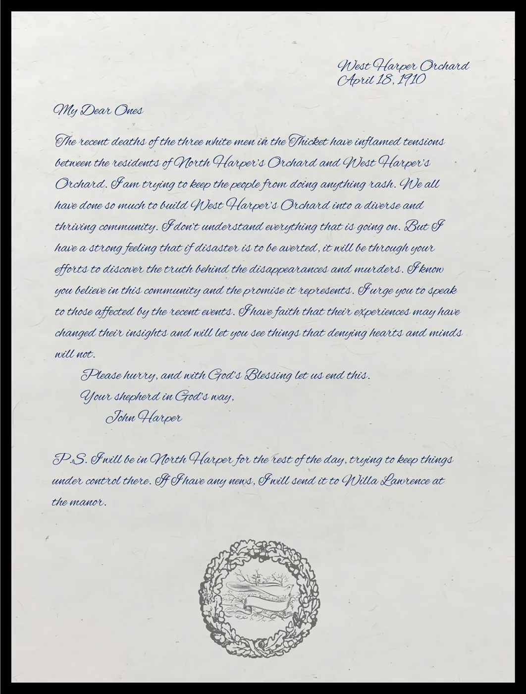

## Раздатки для игроков

> **Раздатка 1. Письмо Джона Харпера**
>
> Западный Харперс-Орчард  
> 18 апреля 1910 года  
> Мои дорогие,  
> Недавние смерти трёх белых мужчин в Чаще разожгли вражду между жителями Северного Харперс-Орчарда и Западного Харперс-Орчарда. Я стараюсь удержать людей от опрометчивых поступков. Мы все столько сделали, чтобы построить Западный Харперс-Орчард — разнообразную и процветающую общину. Я понимаю не всё, что происходит. Но у меня сильное чувство, что если беду и удастся предотвратить, то вашими стараниями раскрыть правду об исчезновениях и убийствах. Я знаю, что вы верите в эту общину и в то, что она обещает. Призываю вас поговорить с теми, кого затронули недавние события. Верю, что пережитое могло изменить их взгляд и позволит вам увидеть то, чего не видят отрицающие сердца и умы.  
> Пожалуйста, поспешите, и с Божьим благословением положим этому конец.  
> Ваш пастырь на пути Господнем,  
> Джон Харпер  
> P.S. Остаток дня я буду в Северном Харпере, постараюсь держать там всё под контролем. Если будут новости, пришлю их Уилле Лоренс в особняк.  

*Прим. перев.:* в письме имя Уилы Лоренс написано «Willa», в описании персонажа — «Wila».
