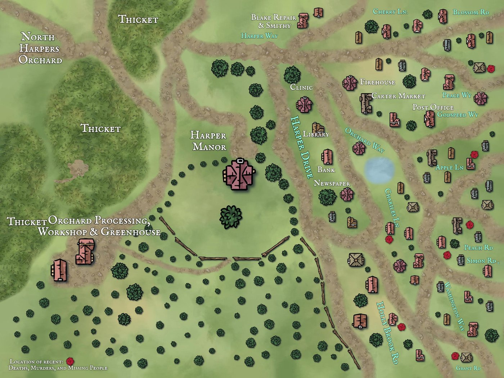
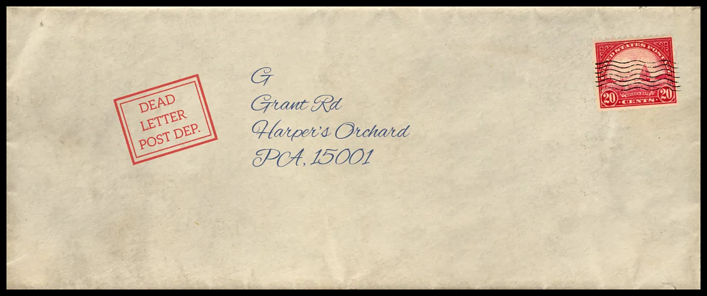

> **Раздатка 2. Карта Харперс-Орчарда**
>
> - Северный Харперс-Орчард; Чаща; особняк Харперов.
> - Центр переработки урожая, мастерская и теплица; «Ремонт и кузница Блейка».
> - Клиника; библиотека; банк; редакция газеты; пожарная часть; рынок Картера; почта.
> - Харперс-уэй, Харпер-драйв, Орчард-уэй, Черри-лейн, Блоссом-роуд, Пис-уэй, Годспид-уэй, Эппл-лейн, Чарльз-лейн, Пич-роуд, Саймон-роуд, Холлибрук-роуд, Вашингтон-уэй, Грант-роуд.
> - Красная отметка: место недавней гибели, убийства или исчезновения.

*Прим. перев.:* на карте «Charles Ln.» и «Apple Ln.», в почтовом журнале — «Charlie Ln.» и «Apple Rd.».

<!-- -->

> **Раздатка 3. Конверт из квартиры Гозы**
>
> [штамп:] ОТДЕЛ НЕВОСТРЕБОВАННЫХ ПИСЕМ ПОЧТЫ  
> Г.  
> Грант-роуд  
> Харперс-Орчард  
> Пенс., 15001  
