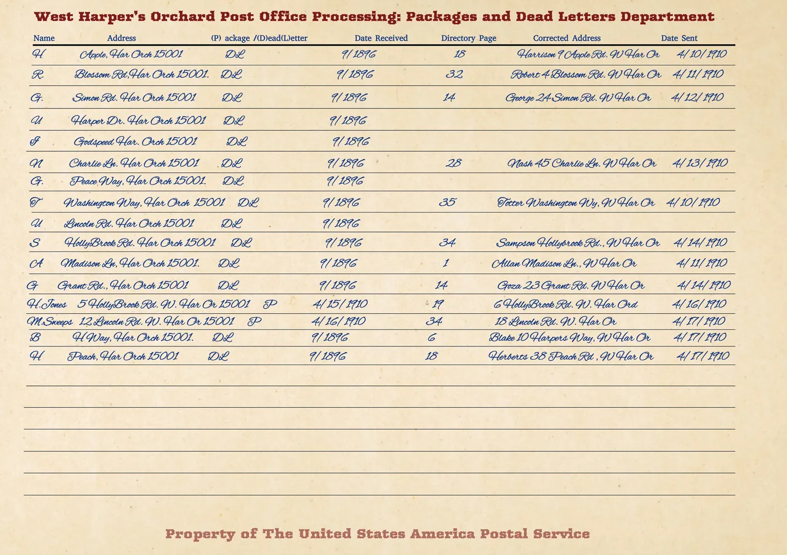

> **Раздатка 4. Почтовый журнал**
>
> Почта Западного Харперс-Орчарда, обработка: отдел посылок и невостребованных писем  
>
> | Имя | Адрес | (П)осылка / (Н)евостребованное письмо | Дата получения | Страница справочника | Исправленный адрес | Дата отправки |  
> | --- | --- | --- | --- | --- | --- | --- |  
> | H | Эппл, Хар. Орч. 15001 | НП | 9/1896 | 18 | Харрисон, 9 Эппл-роуд, З. Хар. Ор. | 4/10/1910 |  
> | R. | Блоссом-роуд, Хар. Орч. 15001 | НП | 9/1896 | 32 | Роберт, 4 Блоссом-роуд, З. Хар. Ор. | 4/11/1910 |  
> | G. | Саймон-роуд, Хар. Орч. 15001 | НП | 9/1896 | 14 | Джордж, 24 Саймон-роуд, З. Хар. Ор. | 4/12/1910 |  
> | U | Харпер-драйв, Хар. Орч. 15001 | НП | 9/1896 | | | |  
> | J | Годспид, Хар. Орч. 15001 | НП | 9/1896 | | | |  
> | N | Чарли-лейн, Хар. Орч. 15001 | НП | 9/1896 | 28 | Нэш, 45 Чарли-лейн, З. Хар. Ор. | 4/13/1910 |  
> | G. | Пис-уэй, Хар. Орч. 15001 | НП | 9/1896 | | | |  
> | T | Вашингтон-уэй, Хар. Орч. 15001 | НП | 9/1896 | 35 | Тоттер, Вашингтон-уэй, З. Хар. Ор. | 4/10/1910 |  
> | U | Линкольн-роуд, Хар. Орч. 15001 | НП | 9/1896 | | | |  
> | S | Холлибрук-роуд, Хар. Орч. 15001 | НП | 9/1896 | 34 | Сэмпсон, Холлибрук-роуд, З. Хар. Ор. | 4/14/1910 |  
> | A | Мэдисон-лейн, Хар. Орч. 15001 | НП | 9/1896 | 1 | Аллан, Мэдисон-лейн, З. Хар. Ор. | 4/11/1910 |  
> | G | Грант-роуд, Хар. Орч. 15001 | НП | 9/1896 | 14 | Гоза, 23 Грант-роуд, З. Хар. Ор. | 4/14/1910 |  
> | Х. Джонс | 5 Холлибрук-роуд, З. Хар. Ор. 15001 | П | 4/15/1910 | 19 | 6 Холлибрук-роуд, З. Хар. Ор. | 4/16/1910 |  
> | М. Свипс | 12 Линкольн-роуд, З. Хар. Ор. 15001 | П | 4/16/1910 | 34 | 18 Линкольн-роуд, З. Хар. Ор. | 4/17/1910 |  
> | B | Х. Уэй, Хар. Орч. 15001 | НП | 9/1896 | 6 | Блейк, 10 Харперс-уэй, З. Хар. Ор. | 4/17/1910 |  
> | H | Пич, Хар. Орч. 15001 | НП | 9/1896 | 18 | Герберты, 38 Пич-роуд, З. Хар. Ор. | 4/17/1910 |  
>
> Собственность Почтовой службы Соединённых Штатов Америки  

*Прим. перев.:* в журнале четыре письма без исправленного адреса, хотя в тексте сценария говорится о двух недоставленных.
