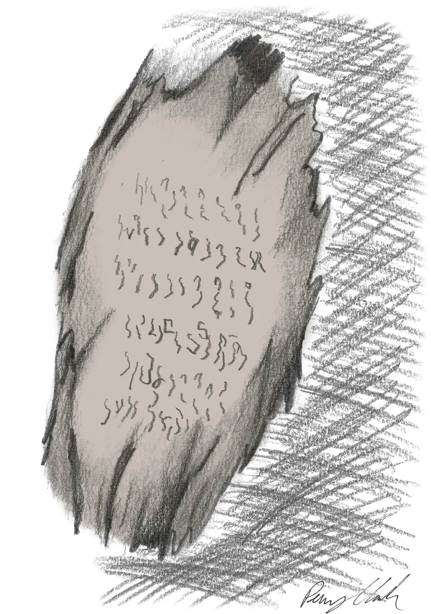

> **Раздатка 5. Кора**
>
> [рисунок: кусок коры с рядами знаков]
>
> **Хранителю на заметку.** На первый взгляд знаки на коре похожи на детские попытки подражать письму.
>
> При успешной проверке МОЩ:  
> «В багряном цвете мы танцуем, а их листья и семена взлетают по ветру. Листья — питать неосвящённую землю. Листья — душить то, что недостойно света. Достойные семена — благословлять и разделять их танец. На ветру — тёмная земля и сладкий свет. Питай…»  
