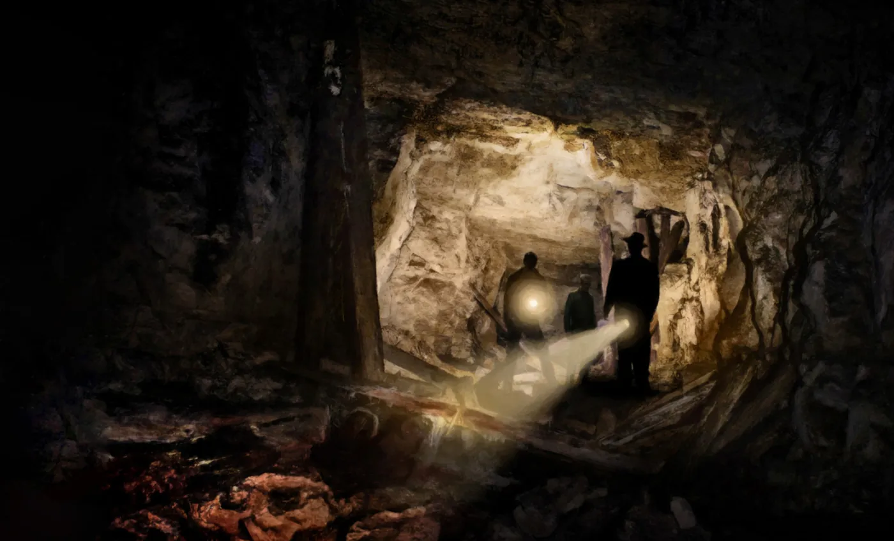

# Мать тысячи младых

Сценарий для «Зова Ктулху» от Поуля Хольмелунда; действие происходит в 1953 году.  
**Сыщики:** 4 • **Время игры:** 3–4 часа

## Вступление

Что трудного в том, чтобы найти двух пропавших влюблённых подростков? Четырёх сотрудников полиции Гроун-Пика, за которых играют участники, отправляют на поиски двоих подростков, исчезнувших с вечеринки в честь шестнадцатилетия. Сыщикам придётся раскрыть и жуткое убийство, и дело о пропаже человека. Сценарий подходит новичкам и опытным игрокам, но затрагивает взрослые темы. Он рассчитан на четырёх предложенных готовых сыщиков.

### Структура сценария

В начале сыщики находятся в полицейском участке. Оттуда их отправляют разобраться в исчезновении двух подростков.

В **акте I** сыщики приезжают на день рождения и узнают от гостей, что пропавшие, по общему мнению, улизнули поцеловаться. В самом популярном в городе месте для свиданий перед сыщиками предстаёт жуткое зрелище: один подросток зверски убит, второй нигде не видно. Тропы и лес поблизости предвосхищают развязку в туннелях упырей. Опасный рельеф, ночные молнии и дикие звери осложняют расследование.

*Прим. перев.:* ночные молнии упомянуты только в этом обзоре; в самих актах их нет.

В **акте II** у сыщиков появляются явные зацепки. Коронер замечает сходство с убийством пятилетней давности: возможно, убийца тот же. Девушка всё ещё не найдена, и, как ни странно, родители не заявили о пропаже. Директор её школы может рассказать о ней и дать домашний адрес. По этому адресу живёт Глэдис Эпплби, заведующая местным сиротским приютом, у которой нет дочери. Новые улики в доме подсказывают, что стоит внимательнее осмотреть приют. Там находятся доказательства против Глэдис и вход в подземные туннели.

**Акт III** разворачивается в тесных туннелях под городом. Сыщики натыкаются на логово упырей, среди которых есть превращённые дети из приюта. Встреча с их опекуншей Глэдис ставит сыщиков перед нравственным выбором. Им предстоит решить, что делать и с Глэдис, и с детьми.
