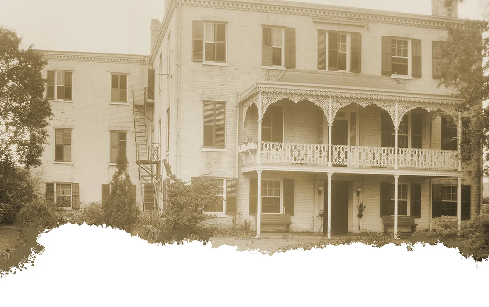

## Предыстория

В 1917–1918 годах Корпус армейских медсестёр направил за океан 5350 американских сестёр, чтобы они служили во Франции вместе с Американским экспедиционным корпусом. Все они пошли добровольно. В лагерных госпиталях и на перевязочных пунктах у фронта они жили в тяжёлых условиях и видели невыразимые ужасы войны. Большинство в конце концов вернулись домой, многие — с душевными ранами и увечьями. С одной случилось нечто куда более жуткое.

Медсестра Глэдис Эпплби повидала больше последствий войны, чем многие. Она ухаживала за детьми, осиротевшими на войне, брошенными или оставшимися без крова. И она столкнулась с нечеловеческими тенями, которые рыскали на нейтральной полосе между армиями. С виду они походили на людей, но жутко жаждали человеческой плоти.

Чем дольше шла война, тем отчаяннее становилось положение подопечных Глэдис. Когда им стала грозить голодная смерть, она обратилась к той же пище, которую видела у упырей: человеческой плоти. Тем же она стала кормить детей. Так Глэдис начала подпадать под власть тёмной богини Шуб-Ниггурат.

В конце концов перемены на фронте позволили вывести Глэдис и сирот в безопасное место.

Домой, в Соединённые Штаты, Глэдис вернулась с изменившимся телом и разумом. Она просыпалась от тревожных снов и обнаруживала, что исписывает листки запретными знаниями: как обратить людей в упырей и тем самым распространить влияние Шуб-Ниггурат. Хуже того, тяга к жуткой пище всё росла.

Годами Глэдис работала в разных сиротских приютах, переезжая с места на место. Она выбирает самых маленьких детей, растит их и кормит, направляя на иной путь. Новые знания позволяют ей сбрасывать кожу, как змее, и принимать другой облик. Каждые пять лет она заманивает юношу, чтобы пожрать его. Так она продлевает себе жизнь и сохраняет силы, а из его органов готовит всё необходимое для превращения детей в упырей.

Пятнадцать лет назад её назначили заведующей сиротским приютом Гроун-Пика. Вскоре город потрясло несчастье: в соседнем лесу нашли тело молодого человека, частично объеденное и без внутренних органов. Заподозрили диких зверей.

Пять лет спустя нашли ещё одного юношу, связанного по рукам и ногам, обескровленного и без внутренних органов. Тело было частично объедено — опять решили, что это звери. Виновного не нашли, и дело осталось нераскрытым.

В ночь, когда начинается расследование, Глэдис в облике школьницы Джуди только что совершила убийство, которое позволит ей прожить ещё пять лет и даст всё необходимое для ритуалов.

### Гроун-Пик

Вымышленный Гроун-Пик — типичный американский городок пятидесятых, навеянный такими фильмами, как «Бриолин». Здесь есть средняя школа, сиротский приют и отдалённый бедный квартал, но город ещё не разросся до окрестных лесов. В лесах много дичи; местные знают, как опасны дикие звери и неприветливый рельеф. Город назван в честь странного звука, который издаёт восточный ветер, переваливая через вершину горы.
