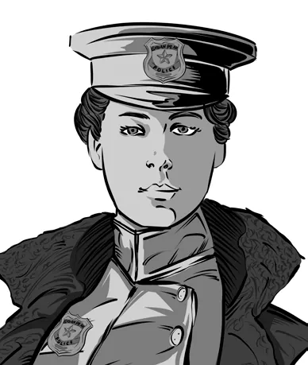
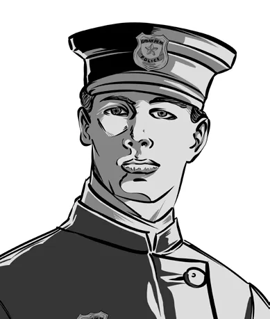
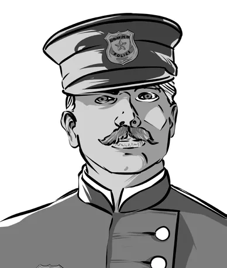
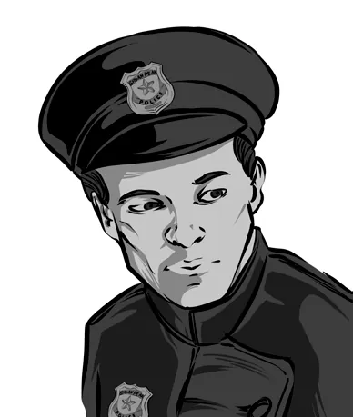

## О сыщиках

Сценарий рассчитан на следующих четырёх сыщиков. Все они служат в полиции Гроун-Пика.

### Роуз Томпсон, 39 лет — Посредница

Спокойная и чуткая, Роуз хорошо понимает чужие чувства и умеет разряжать обстановку. Она не может иметь детей, но в ней силён материнский инстинкт. Раз в месяц она помогает в местном приюте.

**Черты:** чуткость, дар примирять людей, сильный материнский инстинкт.  
**Подсказки к отыгрышу:** стремится защищать детей и поддерживать коллег.

### Сэмюэл Брукс, 29 лет — Честолюбец

Уверен в себе и прямолинеен, ценит дисциплину и физическую силу. Может отступить от правил, чтобы быстрее закрыть дело, но воображением не блещет. Честолюбив: мечтает однажды возглавить полицию Гроун-Пика.

**Черты:** верит в свои силы, нетерпелив и упрям.  
**Подсказки к отыгрышу:** хочет, чтобы итоговый рапорт выставил его в лучшем свете.

### Уолтер Грей, 45 лет — Бюрократ

Дотошен, внимателен к мелочам, нерелигиозен, но глубоко суеверен. Нелюдим, любит охотиться в одиночку, причём больше ради выслеживания: подстрелить оленя, которого уже поймал на мушку, решается редко.

**Черты:** суеверен и склонен к навязчивым привычкам (возможно, лёгкое обсессивно-компульсивное расстройство).  
**Подсказки к отыгрышу:** планы и инструкции дают ему ощущение порядка; предпочитает делать всё по уставу.

### Томми Бейкер, 24 года — Осмотрительный

Добродушен и полон энтузиазма, хотя пережил смерть жены. Один растит двухлетнюю дочь, поэтому осторожен и не рискует без нужды: ему надо вернуться домой целым.

**Черты:** осторожен и предпочитает переговоры силе. Семья превыше всего.  
**Подсказки к отыгрышу:** преданный отец и надёжный коллега; считает сослуживцев почти семьёй и делает всё возможное, чтобы уладить любой конфликт без применения силы.

## Действующие лица

- **Эйбел Картер, начальник полиции.** Строгий человек, в участке у него железная дисциплина. Уже много лет поговаривает об отставке. «Я староват для этой хрени», — ворчит почти так же часто, как: «Мне нужно ещё кофе».
- **Ричард Джонсон, отец Лесли.** Из высшего общества Гроун-Пика, близкий друг мэра. В отличие от жены-снобки он «человек из народа»: знает своё положение, но не считает нужным глядеть на других свысока.
- **Беатрис Джонсон, мать Лесли.** Возглавляет местное благотворительное общество.
- **Лесли Джонсон, предполагаемая девушка Джонни Уилсона.** Убитая горем, зацикленная на себе и отвергнутая шестнадцатилетняя девушка.
- **Джонни Уилсон, звезда школьной команды.** Как считается, встречается с Лесли Джонсон, но ушёл с её вечеринки вместе с Джуди Лейбл.
- **Джуди Лейбл, новенькая в средней школе Гроун-Пика.** По всей видимости, соблазнила Джонни Уилсона и увела с вечеринки.
- **Дэн Гор, директор средней школы Гроун-Пика.** Изменяет жене.
- **Анабелл Скоуг, секретарь директора.** Помогает Дэну Гору в служебных и неслужебных делах.
- **Глэдис Эпплби, заведующая сиротским приютом Гроун-Пика.** Её любят в городе, хотя она живёт затворницей.
- **Мисс Маргарет Коннерли, секретарь Глэдис Эпплби.** Стара как мир и работает в приюте столько, сколько себя помнят горожане.
