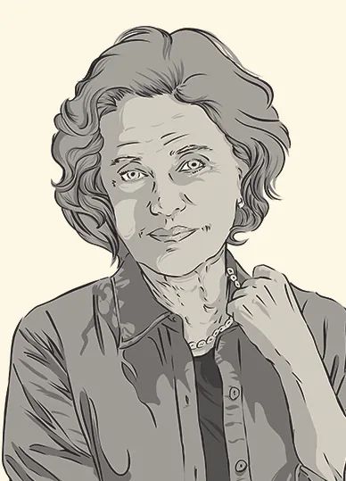
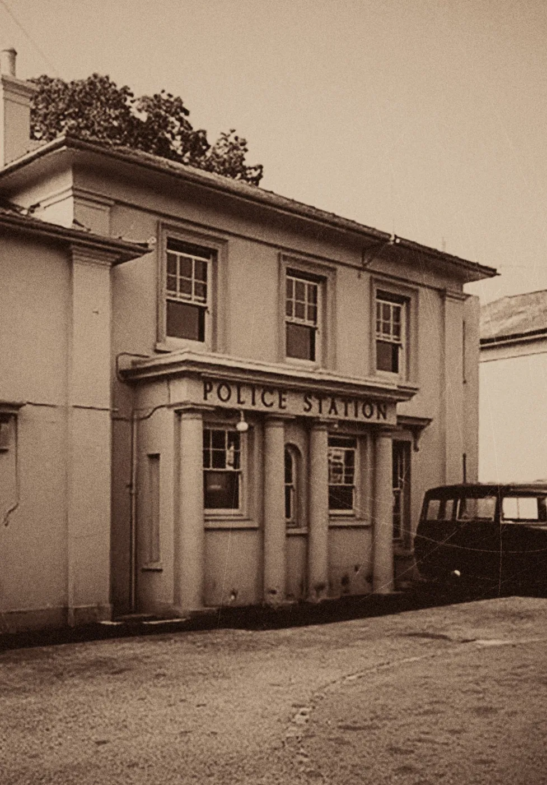

### Противник

#### Глэдис Эпплби, 65 лет

**Ведьма-полуупырь Шуб-Ниггурат**

На удивление проворна для своих лет. У неё приветливое морщинистое лицо обыкновенной бабушки, кудрявые волосы и живые глаза. В городе её знают как нелюдимую заведующую местным сиротским приютом. Она живёт одна на окраине и, похоже, ни с кем близко не дружит. И всё-таки её любят, хоть она и считается «приезжей» — подумаешь, каких-то пятнадцать лет здесь живёт. Она обаятельна и отзывчива, любит детей и никогда не откажет ребёнку в помощи, если тому плохо или больно. Как ведьма Шуб-Ниггурат Глэдис неустанно превращает человеческих детей в упырей. Она и сама медленно становится упырём: делается быстрее, сильнее и выносливее, но пока выглядит человеком. Заклинание Управлять кожей позволяет ей менять внешность и скрывать перемены в собственном теле. Она не брезглива, но убивает лишь по необходимости или ради магических ритуалов.

## Акт I. Пропавшие подростки

Вечер пятницы, смена подходит к концу. Четверо сыщиков, сотрудники полиции Гроун-Пика, от нечего делать играют в покер на мелочь. Чуть позже десяти вечера звонят Джонсоны. На празднике по случаю шестнадцатилетия их дочери Лесли пропали двое гостей-подростков.

Прочитайте или перескажите слова начальника полиции:

> «Звонили Джонсоны, из Блю-Хилл. С дня рождения пропали двое подростков. Небось влюбились и забрели куда-нибудь с тропы. Съездите, разберитесь. Обычно я бы послал одну машину, но Джонсоны дружат с мэром. Покажем, что к бедам уважаемых граждан мы относимся серьёзно. Знаю, смена вот-вот кончится, но дело на пять минут. Так что не вздумайте записывать себе кучу сверхурочных».

Выдайте сыщикам **Раздатку 1. Карта Гроун-Пика**.

### Встреча с Джонсонами

По указанному адресу в районе Блю-Хилл сыщиков встречает Ричард Джонсон. Он рад, что полиция отнеслась к делу серьёзно и прислала четверых сотрудников. На подъездной дорожке и вдоль улицы стоят машины. Большинство гостей разъехались, но несколько школьников и их родителей ещё здесь. Лесли Джонсон, которой только исполнилось шестнадцать, описывает пропавших: Джонни Уилсон в куртке команды, Джуди Лейбл в нарядном жёлтом платье и туфлях в тон. Они ушли, держась за руки. Лицо Лесли в слезах, настроена она враждебно. «Я знаю, куда эта дрянь его увела, — ядовито говорит она. — Такая дешёвка на смотровой площадке ему всё позволит». Мать, Беатрис Джонсон, одёргивает её за грубость, но соглашается, что детям так вести себя неприлично.

*Прим. перев.:* в оригинале отца Лесли на с. 209 зовут Ричардом, здесь — Клайдом; имя Лесли пишется то «Lesley», то «Leslie».

Если спросить, Джонсоны скажут, что одобряют ухаживания Джонни за Лесли: он хороший мальчик из приличной семьи. Разумеется, они разочарованы тем, как он обошёлся с их дочерью. Несколько гостей расскажут, что Джуди новенькая: учится в школе всего две недели. Лесли вставит, что пригласила её из вежливости и ни за что не сделала бы этого, знай она, какая та распущенная.

Если сыщики догадаются проверить пунш, обнаружат, что в него добавлен алкоголь. Мистер Джонсон, конечно, уверяет, что отдельная чаша с безалкогольным пуншем стояла для
