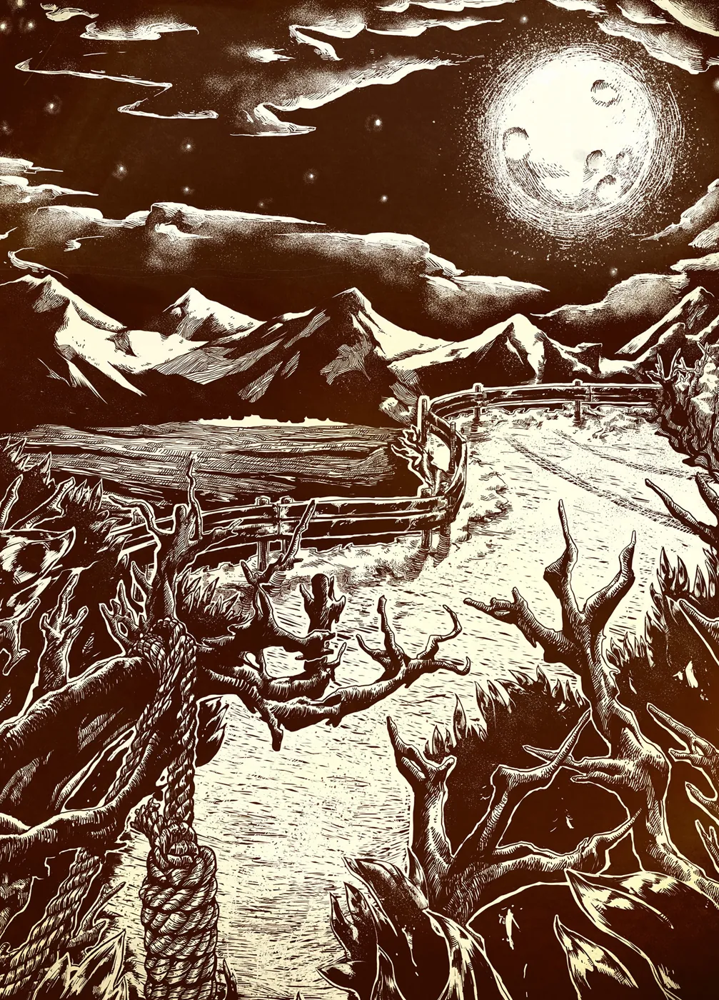

подростков: они никогда не стали бы поить несовершеннолетних. Успешная проверка Психологии показывает, что он лжёт. Если припереть его к стенке, он отмахнётся: ничего страшного. Сыщики могут заподозрить, что подростки уехали и попали в аварию из-за выпивки.

Снаружи сыщики видят, что кабриолет Джонни Уилсона — Ford Crestline Sunliner 1952 года — так и стоит на подъездной дорожке. Видно, сколько в него вложено труда. Лесли считает странным, что Джонни оставил машину: это его гордость, а в старую развалюху Джуди, коричневый пикап Ford 1946 года, он бы ни за что не сел. Остальные подростки с ней согласны.

*Прим. перев.:* после «Convertible» в оригинале напечатана необъяснённая цифра «2».

Если сыщики осмотрят машину Джонни, то ничего необычного не найдут, кроме жестянки с презервативами в бардачке.

### Стоянка у смотровой площадки

Дорога до смотровой площадки занимает полчаса. Если сыщики торопятся, они могут включить сирену и ехать быстрее, сократив время вдвое, но нужна проверка Вождения автомобиля. При провале они понимают, что ехать так опасно, и сбрасывают скорость. Критический провал или провал повторной проверки означает, что лопнет шина: сыщики задержатся и, скорее всего, получат выговор от начальника.

Над смотровой площадкой низко висит полная луна, заливая всё бледным светом. Стоянка на вид пуста, на гравии видны только следы шин одной машины. Успешная проверка Внимания показывает, что следы свежие, оставлены этим вечером.

Вдоль лесной кромки стоянки сыщики находят разбросанную мужскую одежду: она ведёт в дальний конец площадки. Успешная проверка Психологии или Чтения следов наводит на мысль, что одежду снимали в спешке, но не силой, и бросали по одной вещи, словно раздевались на ходу.

В самом тёмном углу стоянки на дереве в петле висит изувеченное обнажённое тело Джонни. При виде тела нужна проверка Рассудка (потеря 1/1d4). При провале сыщик невольно что-нибудь делает, например роняет фонарь. При провале проверки Удачи лампочка разбивается.

Тело вскрыто глубоким разрезом от горла до пупка, явно острым орудием. В брюшной полости не хватает органов. Половой член и яички отрезаны. Тело обглодано: от пальцев на руках и ногах остались кости да сухожилия, а из рук и ног вырваны куски мяса.

Зрелище жуткое. Каждый сыщик вспоминает, как пять лет назад молодого человека убили тем же способом. Хранителю стоит спросить Уолтера Грея, какие чувства у него вызывает сходство с давним делом.

*Прим. перев.:* здесь Уолтер в оригинале назван «Walther», на листе сыщика — «Walter».

Под телом небольшая лужа крови. Успешная проверка Естествознания или Криминалистики показывает: крови меньше, чем должно быть при таких ранах. В лес ведут несколько размытых или затоптанных следов. Внимание, Естествознание или Чтение следов позволяют заметить, что следы похожи на отпечатки копыт.

Если сыщики хотят сразу пойти по следу, предложите проверку Идеи: возможно, сперва стоит доложить о случившемся. Если доложат, начальник велит оцепить место и искать улики. Коронер и сотрудники ночной смены уже выезжают.

### Блуждание в лесу

Если сыщики идут в лес по следу, напомните о предупреждающей табличке: тропы опасны. В лесу они постепенно замечают, что обычных звуков зверей и птиц не слышно — как бывает, когда поблизости хищник.

Темнота, неровная почва и плохая видимость до добра не доведут. Все сыщики проходят проверку ЛВК. При провале сыщик подворачивает ногу и получает 1
