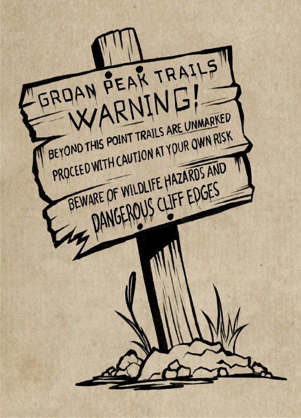

пункт урона, а при крахе или провале повторной проверки — 1d4.

При успешной проверке Чтения следов или Внимания сыщики замечают под корнями упавшего дерева вырытый в земле ход. На первый взгляд это нора лисы или барсука, только вход шире обычного. Сыщики с ТЕЛ не больше 60 могут протиснуться внутрь, хоть и с трудом. Через 5–10 м ход обваливается, едва не погребая сыщика. Этот случай предвосхищает подземные ходы и опасности, которые ждут сыщиков дальше.

> **Тропы Гроун-Пика. Внимание!** Дальше тропы не размечены. Соблюдайте осторожность и идите на свой страх и риск. Берегитесь диких зверей и опасных обрывов.

### Интерлюдия

Если сыщики доложили об убийстве, местный коронер и подкрепление приезжают, чтобы оцепить место и отвезти тело в морг. Если не доложили, начальник требует доклада по радио через диспетчера. Затем велит дождаться коронера и ночной смены. Он и сам приезжает на место с ночной сменой, отправляет сыщиков домой отдыхать и приказывает явиться утром на инструктаж. Если те возражают, он их осаживает: какой от них толк, когда они еле стоят на ногах после полной смены?

## Акт II. Поиски

### Инструктаж в участке

Утром в участке сыщиков знакомят с заключением коронера. Причина смерти — потеря крови от вертикального разреза, сделанного орудием не менее острым, чем скальпель, но крупнее, вроде походного ножа. Иначе жертва умерла бы от удушения в петле. Половой член, яички и внутренние органы удалили после смерти, вероятно тем же ножом. Судя по ничтожному количеству крови на месте, бо́льшую её часть собрали и унесли. Коронер уверен, что это дело рук того же человека, который совершил нераскрытое убийство пять лет назад.

Зато следы укусов ставят коронера в тупик. Одни почти человеческие, другие похожи на следы клыков койота. Они разной величины, от маленьких до крупных. Коронер подозревает небольшую стаю разновозрастных животных.

Ночная смена не нашла новых следов Джуди или её машины. Начальник недоумевает, почему родители не заявили о её пропаже, и предлагает наведаться к ней домой. Адрес на удивление трудно найти. Сыщики могут вспомнить, что Джуди переехала в город недавно. Проверка Идеи или подсказка начальника направит их в школу, где адрес можно спросить у директора.

### Директор Гор

Дэна Гора нет дома. Жена говорит, что он в школе: хоть сегодня и суббота, разбирает бумаги со своей секретаршей, Анабелл Скоуг.

В кабинете сыщики застают директора за усердной работой с секретаршей, вот только бумаги, похоже, ни при чём. Сгорая со стыда, секретарша поправляет одежду, уходит в приёмную и закрывает за собой дверь. Директору стыдно, что его застали, и он в ужасе от рассказа о вчерашних событиях. Он обещает помочь и умоляет не рассказывать о том, что сыщики увидели.

Гор говорит, что Джуди новенькая, учится здесь всего дней четырнадцать, но уже освоилась как рыба в воде. Её сразу полюбили и преподаватели, и ученики. Она не доставляла хлопот и, похоже, быстро завела друзей. Гор предполагает, что родители Джуди не особенно состоятельны: судя по адресу, они живут в бедной части города.
