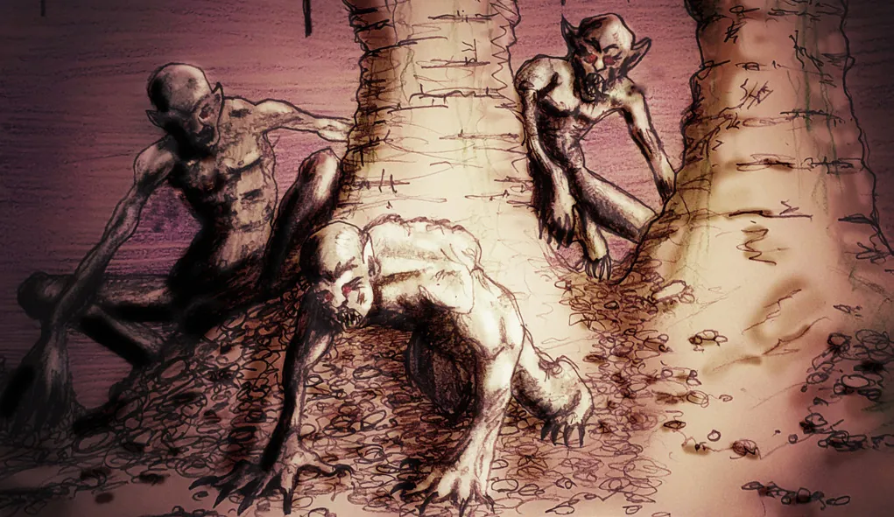

## Последний акт. Противостояние

### Под землёй

Под городом и окрестными лесами тянется обширная сеть туннелей. Неизвестно, зачем их проложили изначально, но колония упырей под началом Глэдис обжила и расширила их. Глэдис с приёмными детьми пользуется ходами, чтобы не попадаться людям на глаза и передвигаться незаметно. Входов много, в том числе возле места убийства, у приюта и в доме Глэдис. Хранитель при необходимости может придумать другие. Под землёй сыщиков ждут многочисленные трудности и опасности.

Заблудиться нетрудно. Туннели — настоящий лабиринт, а в темноте легко потерять всякое чувство направления. Неполная карта из дома Глэдис помогает; пригодятся и верёвка, бечёвка или метки мелом. От любого входа до центральной пещеры в сердце лабиринта два часа пути. Ошибки и происшествия увеличивают это время.

С картой сыщики за два часа доберутся до центральной пещеры и встретятся с Глэдис. Без карты путь займёт четыре часа, но разрешите проверку Слуха, Чтения следов или Внимания: обычный успех сокращает путь на 30 минут, трудный — на час, чрезвычайный — на два.

Чем дольше сыщики под землёй, тем больше риск обвала. Ходы, вырытые упырями, не везде безопасны для людей. Обвал может лишь задержать сыщиков, а может заживо их похоронить. Предусмотрительные сыщики принесут инструменты, чтобы откопаться. Остальным придётся импровизировать.

За каждый час под землёй сыщики проходят групповую проверку Удачи. При провале случается небольшой обвал. Если они говорят, что идут осторожно, не задевают кучи земли, подпирают опасные участки подручными материалами или захватили инструменты, дайте им бонусную кость. Земля, корни и камни наносят каждому 1d4 урона, которого можно избежать при успешном Уклонении. Прибавьте 15 минут на то, чтобы откопать пострадавших или расчистить проход.

Под землёй сыщики могут страдать от клаустрофобии. Теснота, странные звуки, свежая и засохшая кровь, кости людей и зверей — всё это делает туннели жутким местом. Чтобы передать это ощущение, каждый сыщик проходит проверку Рассудка (потеря 0/1d3) в случайные моменты, не реже раза за каждые два часа в туннелях.

### Противостояние с Глэдис

Пещера в центре лабиринта — логово стаи упырей и их матери, ведьмы Глэдис Эпплби. Сыщики застают её посреди пещеры вместе с детьми-упырями. Здесь и трое взрослых упырей — те самые дети из Франции. По пещере рассредоточены ещё двое упырей-подростков и трое упырей-детей: сыщики оказываются в окружении.

Глэдис сперва пытается договориться. Она прибегает к заклинаниям «Внемли Матери» и Покорение, взывает к сочувствию сыщиков и к тому, что сама считает «здравым смыслом». Она хочет, чтобы они поняли: она помогает детям и растит их так, чтобы они научились выживать самостоятельно. Она убеждает сыщиков уйти и забыть всё, что они видели. Если она будет достаточно убедительна, некоторые сыщики могут выступить против остальных. Во время разговора сыщики постепенно замечают, как вокруг них движутся упыри и дают знать о своём присутствии. Роуз узнаёт детей из приюта, которых якобы усыновили.

Если уговоры не помогают, Глэдис предлагает сделку. Она готова сдаться и во всём признаться, если сыщики отпустят её «детей». Они невинны, говорит она, и не должны страдать за её преступления.

Лишь когда ничто другое не помогает, Глэдис переходит к угрозам. Она даёт понять, что сыщики в смертельной опасности и всецело во власти её и детей. Если дело доходит до боя, она велит младшим бежать, а не погибать в схватке. Если Глэдис погибнет, для каждого упыря определите с вероятностью 50%, убежит ли он в ужасе, увидев смерть матери, или будет мстить и драться насмерть.
