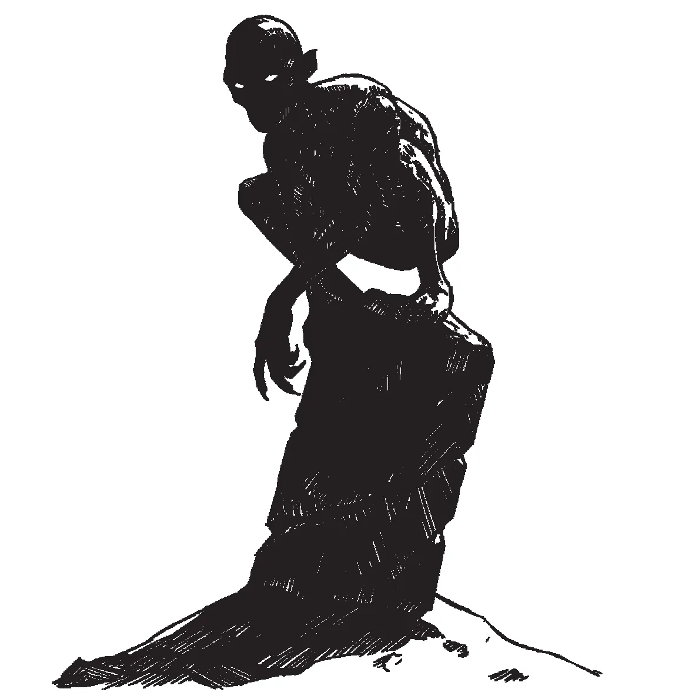

## Персонажи и чудовища

### Взрослые упыри

**«Дети окопов»**

```stat
СИЛ 75  ВЫН 65  ТЕЛ 65  ЛВК 65  ИНТ 65
НАР —   МОЩ 65  ОБР —   РАС —
ПЗ 13  БкУ +1d4  Комплекция 1  Скорость: 8  ПМ 13  Удача —
Атак за раунд: 3 (укус, когти, пинок)
Ближний бой (Драка) 40% (20/8), урон 1d6+1d4
Укус с захватом (боевой приём) 40% (20/8), урон 1d4 за раунд
Уклонение 40% (20/8)
Особые способности
Укус с захватом: после успешного укуса упырь может не атаковать когтями, а удерживать жертву. Он автоматически наносит 1d4 урона за раунд, пока жертва не вырвется, победив во встречной проверке СИЛ.
Броня: огнестрельное и метательное оружие наносит половину выпавшего урона, с округлением вниз.
Потеря Рассудка: 0/1d6 при встрече со взрослым упырём.
```

### Упыри-подростки

**Порождение Глэдис**

```stat
СИЛ 60  ВЫН 65  ТЕЛ 55  ЛВК 60  ИНТ 60
НАР —   МОЩ 65  ОБР —   РАС —
ПЗ 11  БкУ 0  Комплекция 0  Скорость: 8  ПМ 12  Удача —
Атак за раунд: 2 (укус, когти, пинок)
Ближний бой (Драка) 35% (17/7), урон 1d6+БкУ
Укус с захватом (боевой приём) 35% (17/7), урон 1d4 за раунд
Уклонение 35% (17/7)
Особые способности
Укус с захватом: после успешного укуса упырь может не атаковать когтями, а удерживать жертву. Он автоматически наносит 1d4 урона за раунд, пока жертва не вырвется, победив во встречной проверке СИЛ.
Броня: огнестрельное и метательное оружие наносит половину выпавшего урона, с округлением вниз.
Потеря Рассудка: 0/1d4 при встрече с упырём-подростком.
```

*Прим. перев.:* расчёт даёт 12 ПЗ и 13 ПМ; оставлены печатные значения. При двух атаках книга перечисляет три вида. Для 35% указана пятая доля 6; исправлено на 7 во всех трёх строках.

### Упыри-дети

**«Усыновлённые» из приюта**

```stat
СИЛ 40  ВЫН 45  ТЕЛ 40  ЛВК 55  ИНТ 55
НАР —   МОЩ 55  ОБР —   РАС —
ПЗ 8  БкУ −1d4  Комплекция −1  Скорость: 7  ПМ 9  Удача —
Атак за раунд: 2 (укус, когти)
Ближний бой (Драка) 30% (15/6), урон 1d6−1d4
Укус с захватом (боевой приём) 30% (15/6), урон 1d4 за раунд
Уклонение 30% (15/6)
Особые способности
Укус с захватом: после успешного укуса упырь может не атаковать когтями, а удерживать жертву. Он автоматически наносит 1d2 урона за раунд, пока жертва не вырвется, победив во встречной проверке СИЛ.
Броня: огнестрельное и метательное оружие наносит половину выпавшего урона, с округлением вниз.
Потеря Рассудка: 0/1d3 при встрече с упырём-ребёнком.
```

*Прим. перев.:* расчёт даёт 11 ПМ и БкУ −1; оставлены печатные значения. Укус с захватом в строке атаки наносит 1d4, а в описании способности — 1d2. Для 30% указана пятая доля 5; исправлено на 6 во всех трёх строках.


