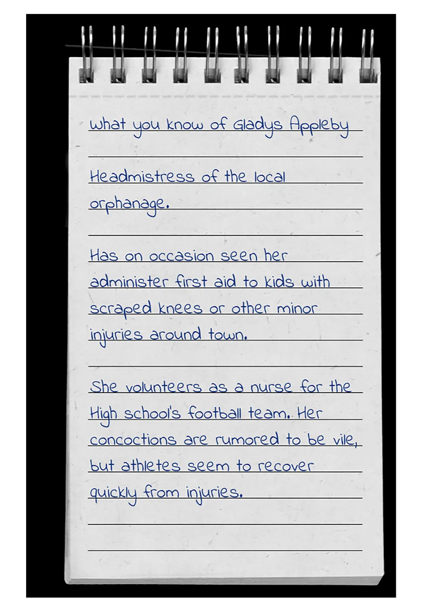

> **Раздатка 3. Что Сэмюэл знает о Глэдис**
>
> Что ты знаешь о Глэдис Эпплби  
> Заведующая местным приютом.  
> Иногда видел, как она оказывает первую помощь детям с ободранными коленками или другими мелкими ушибами по всему городу.  
> Она добровольно работает медсестрой футбольной команды школы. О её снадобьях ходят слухи, что они мерзкие, но спортсмены, похоже, быстро оправляются от травм.  
