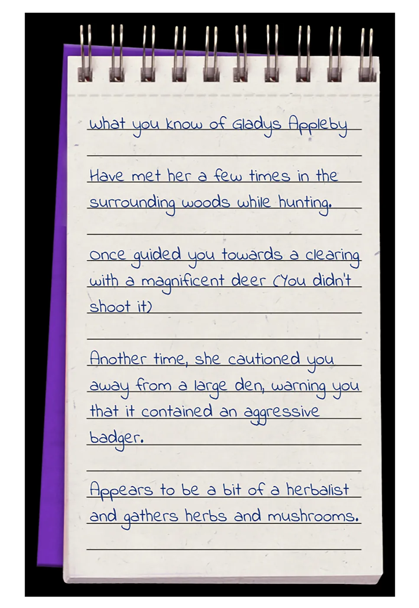

> **Раздатка 4. Что Уолтер знает о Глэдис**
>
> Что ты знаешь о Глэдис Эпплби  
> Несколько раз встречал её в окрестных лесах на охоте.  
> Однажды она вывела тебя к поляне с великолепным оленем (ты не выстрелил).  
> В другой раз она предостерегла тебя от большой норы, сказав, что там живёт злой барсук.  
> Похоже, она немного травница — собирает травы и грибы.  
