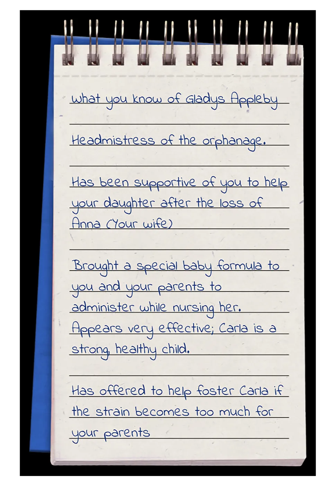

> **Раздатка 5. Что Томми знает о Глэдис**
>
> Что ты знаешь о Глэдис Эпплби  
> Заведующая приютом.  
> Поддерживала тебя, помогала с дочерью после смерти Анны (твоей жены).  
> Принесла тебе и твоим родителям особую детскую смесь, чтобы давать дочке при кормлении. Смесь, похоже, очень действенная: Карла — сильный, здоровый ребёнок.  
> Предлагала взять Карлу на воспитание, если твоим родителям станет слишком тяжело.  
