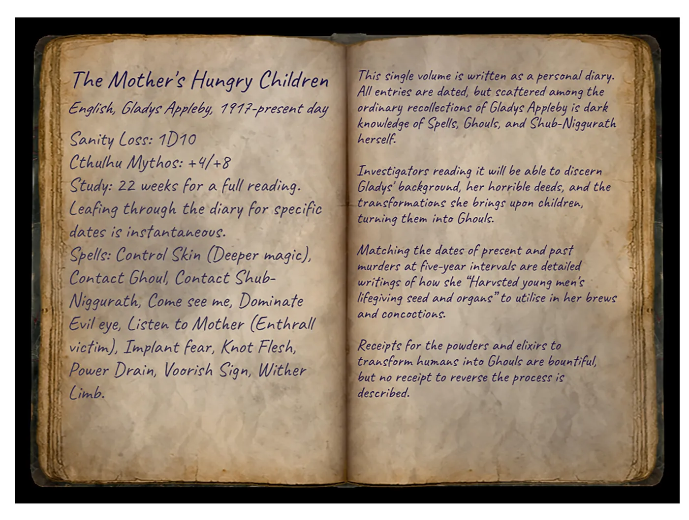

> **Раздатка 6. «Голодные дети Матери»**
>
> Голодные дети Матери  
> Английский, Глэдис Эпплби, с 1917 года по сей день  
> Потеря Рассудка: 1d10  
> Мифы Ктулху: +4/+8  
> Изучение: 22 недели на полное чтение. Пролистать дневник в поисках определённых дат можно мгновенно.  
> Заклинания: Управлять кожей (усиленная версия), Связь с упырём, Связь с Шуб-Ниггурат, «Приди ко мне», Покорение, Сглаз, «Внемли Матери» (Околдовать жертву), Зародить страх, Скрутить плоть, Истощение сил, Вурский знак, Усыхание конечности.  
> Этот единственный том написан как личный дневник. Все записи датированы, но среди обычных воспоминаний Глэдис Эпплби разбросано тёмное знание о заклинаниях, упырях и самой Шуб-Ниггурат.  
> Читатель сможет разобраться в прошлом Глэдис, её чудовищных делах и превращениях, которым она подвергает детей, превращая их в упырей.  
> Сверив даты нынешнего и прошлых убийств с пятилетними промежутками, находишь подробные записи о том, как она «собирала у юношей животворное семя и органы», чтобы пускать их в свои варева и снадобья.  
> Рецептов порошков и эликсиров, превращающих людей в упырей, много, но рецепта, обращающего процесс вспять, нет.  

*Прим. перев.:* в рукописном оригинале «Harvsted» вместо «Harvested», а «Receipts» означает рецепты. «Внемли Матери» — название из перевода раздатки в базе; в тексте сценария это заклинание названо «Внемли Матери».
