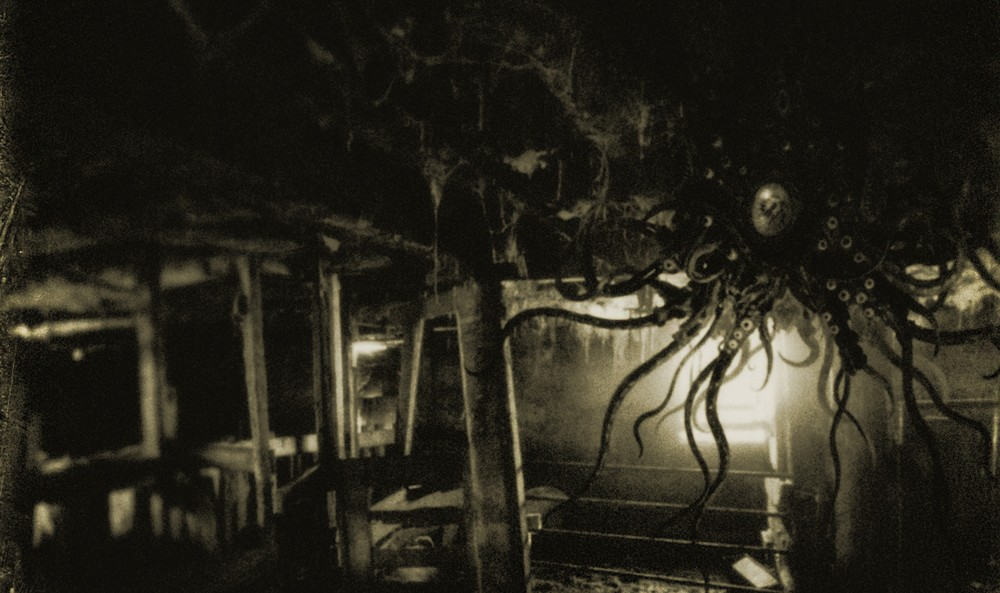

> «Вечно славьте Их, и да пребудет изобилие у Чёрной Козы Чащоб. Йа! Шуб-Ниггурат! Йа! Шуб-Ниггурат! Чёрная Коза Чащоб с Тысячью Младых!»
>
> — Г. Ф. Лавкрафт, «Шепчущий во тьме»

У неё много имён: Всематерь, Чёрная Коза, Владычица Лесов, Великая Мать. В каждом — попытка людей дать имя непостижимому величию потустороннего божества Шуб-Ниггурат. «Год Козла» воздаёт почести Великой Древней во всех её обличьях: в сборнике двенадцать сценариев от новых и опытных авторов **Miskatonic Repository**. Каждый сценарий — самостоятельное расследование, и все они разбросаны во времени и пространстве. Действие происходит в Тёмные века, в эпоху газовых фонарей, в классические 1920-е и в современности.

Среди более чем пятидесяти готовых сыщиков — родители с добрыми намерениями, но без понимания собственных детей, люди вне закона времён Английской гражданской войны и финские музыканты, играющие дэт-метал. Эти истории говорят о семье, зачатии, самосовершенствовании, мутации, созидании и многом другом. Они приглашают вас на вакханалию ужаса, которая закончится лишь тогда, когда вы станете теми, кем вам суждено стать, как бы страшно это ни оказалось.
