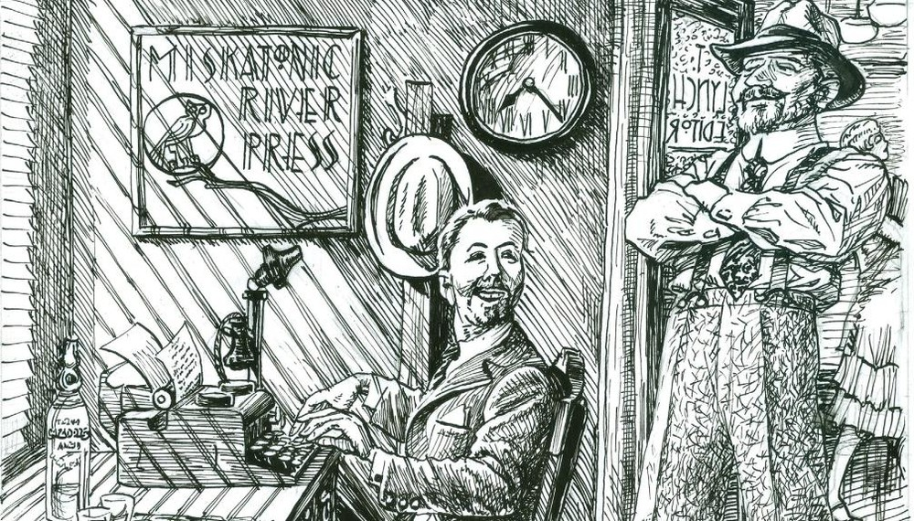

# Тварь на моём пороге

В отслеживании UPS значилось, что посылки уже везут. Но шёл снег. И посылки были очень важные. То и дело я отрывался от дел, подходил к окну и смотрел на подъездную дорожку. Хоть бы снегопад не отпугнул водителя UPS. Наконец во второй половине дня раздался звонок, и я буквально полетел к двери. Вот они, несколько коробок, в тонких пластиковых пакетах от непогоды. Я крикнул водителю спасибо. Он махнул рукой и укатил в густеющий снег.

Дождался. Наконец-то дождался. В этих коробках была мечта всей моей жизни и сбывшаяся Мечта моего товарища по этому делу, одна из многих. Я вскрыл коробку и рухнул в кресло у стола, едва дыша. Дрожащими пальцами запустил Skype и дважды щёлкнул по имени партнёра.

— Ну как выглядят? — без предисловий спросил Кит Хербер, глава Miskatonic River Press.

— Потрясающе, Док. Вот, погляди. — Я поднял экземпляр «Новых историй долины Мискатоника», чтобы он мог его рассмотреть. Книга была загляденье. Простая. Изящная. Вышедшая в свет. Miskatonic River Press вступило в мир «Зова Ктулху». Правда, ещё прошлой осенью мы переиздали «Мёртв, но видит сны», высоко оценённую критиками антологию лавкрафтианской прозы. Но только первая игровая книга могла показать, по силам ли нам это дело.

Мы ещё немного поговорили. Я листал книгу, показывал вёрстку, иллюстрации и таблицы. Обсудили, на какие конвенты мне поехать, чтобы продавать книги и рассказывать о новом издательстве.

Через два месяца мы как раз планировали, как Кит прилетит из Флориды в Нью-Йорк на местный конвент, когда у меня зазвонил мобильный.

— А вот и он! — сказал я. Я ждал его звонка.

Но это был не он. Звонила его жена Шэрон.

Кит «Док» Хербер умер. Внезапно. Обширный инфаркт. Ночью.

Мы плакали, отменяли планы, делились мыслями.

Док повлиял на стольких людей и со столькими успел поработать, что трудно было представить, как всё пойдёт без него. Но мы с Шэрон нашли выход и сохранили Мечту… на какое-то время. Док успел передать мне столько, что меньше чем за год я научился вести издательство. Только без помощи мне было не обойтись. Выходили новые замечательные игровые книги и сборники прозы. Столько талантливых людей пришло на выручку. Появились друзья.

А теперь факел перешёл в другие руки.

Miskatonic River Press, или MRP, несло его высоко несколько лет, даже после ухода Дока.

Теперь факел у Stygian Fox. Среди друзей, которых я обрёл благодаря MRP, была Стефани Макалеа. Теперь её когти крепко держат факел, высоко над головой, чтобы отогнать чернильную ночь. Поистине мрачны её Мечты, и с её помощью они стали лавкрафтианской реальностью.

За Дока и за Стеф! Йа!

*Спасибо за все эти воспоминания,*  
*Том Линч*  
*Сентябрь 2019 года*

