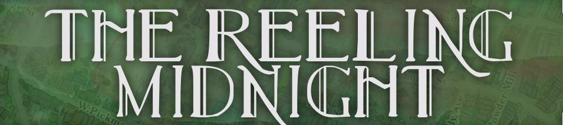
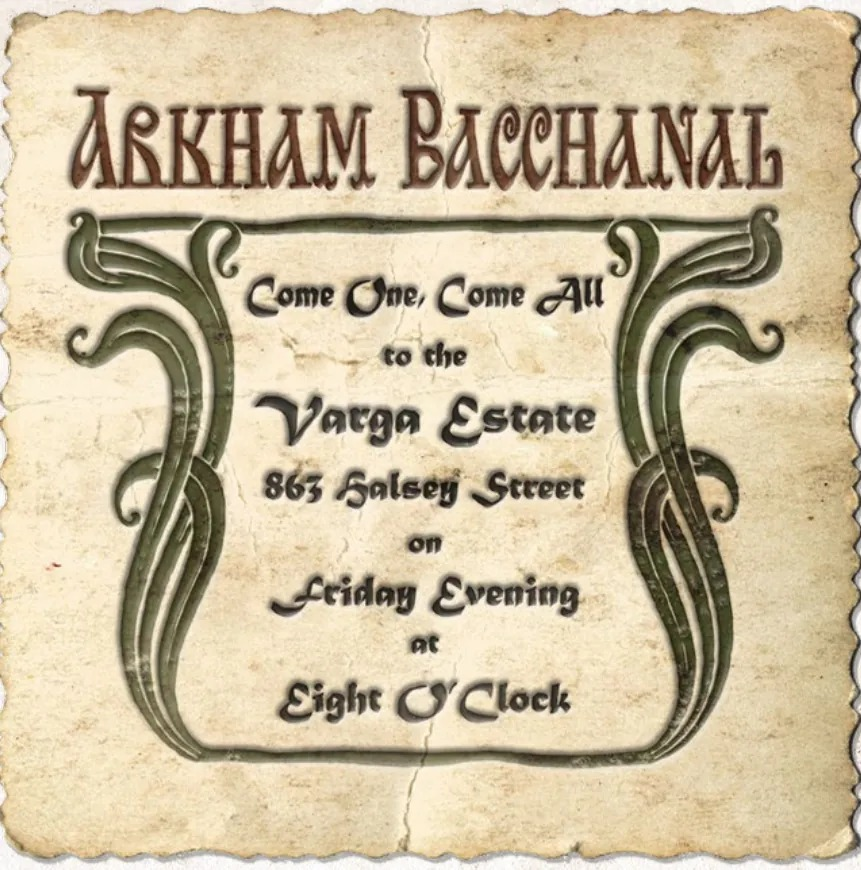

# Шальная полночь

На дворе конец двадцатых, и век джаза наконец докатился до провинциального Аркхэма. Свинг, выпивка из-под полы, азартные игры, танцы и девиз «живи сегодняшним днём» многое изменили в городке.

Тон задаёт графиня Ариадна Варга, венгерская дворянка в изгнании. В смуту после Великой войны её семью лишили родового поместья. Яркая и модная, с безупречным вкусом Старого Света, молодая графиня собирает на своих вечерах людей из разных кругов. Здесь и представители старейших и богатейших семейств Аркхэма, и профессор-другой из Мискатоникского университета, и богема — художники, музыканты, поэты. В определённых кругах эти вечеринки и слухи о том, что там творится, у всех на устах. Многим хочется попасть туда хотя бы из любопытства, да только приглашения достаются избранным.

Буквально на прошлой неделе о событиях на одной из вечеринок Варги написала в еженедельной светской колонке «Аркхэм Адвертайзер» Мэделин Манчестер, журналистка по совместительству и светский обозреватель.

## Сведения для Хранителя

А ведь огласка — последнее, что нужно Ариадне или её дяде Золтану Варге. Оба вовсе не венгры и друг другу не родня. Двое мошенников затеяли хитрое дело: обобрать пару аркхэмских богачей и скрыться. За три месяца всё сложилось как надо. Выдавая себя за венгерских дворян в изгнании, они сняли обветшалый, но вполне пригодный особняк по адресу Холси-стрит, 863, в небогатом квартале. Вскоре Золтан Варга, он же пятидесятипятилетний Девон Маккой, вышел на своих простаков: двух пожилых аркхэмцев, которых уже обработал за долгую переписку. Он стал устраивать в съёмном доме вечера с бренди и бриджем для людей в годах и при положении.

Ариадна заскучала и вскоре стала приглашать своих гостей, к большому неудовольствию старшего партнёра. Его жалобы ни к чему не привели. Однажды в пылу ссоры она даже пригрозила их выдать. В последние недели она не раз уходила поздно вечером и, судя по всему, часами бродила по улицам, возвращаясь лишь под утро. Сколько Золтан ни требовал объяснений, ответа он так и не добился.

Всё более странные выходки Ариадны тревожат дядю Золтана, но он твёрдо намерен довести дело до конца. Ещё несколько дней, и благодетели вручат ему свыше 35 000 долларов наличными, а они с Ариадной уедут из города.

## Золтан Варга, он же Девон Маккой

Девон вырос на суровых улицах южного Бостона и рано понял, что головой заработает больше, чем кулаками. В семнадцать лет Маккой уже колесил по стране с наставником-картёжником. Немногие друзья звали того Гарри Шляпой, сотни других знали его под десятком вымышленных имён. К тому дню, когда Гарри пристрелили в подсобке кливлендского бара, Девон уже перенял у него всё, чему тот мог научить.

Наставник его был наглым пьяницей и сквернословом, а Девон умел обаять и располагал к себе улыбкой. Он быстро научился обращать это себе на пользу…

> **Раздатка доп. 1. Приглашение «Аркхэмская вакханалия»**
>
> АРКХЭМСКАЯ ВАКХАНАЛИЯ  
> Приходите все  
> в поместье Варга  
> Холси-стрит, 863  
> в пятницу вечером  
> в восемь часов
