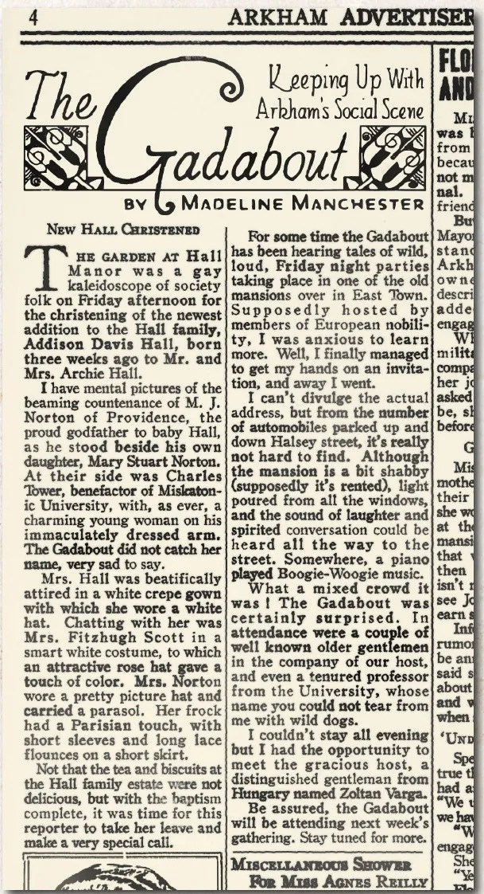

…а ловкость с картами стала для него средством добиваться своего. Учитель же жил карточным шулерством по принципу «хватай и беги» и за него поплатился жизнью.

Маккой считает аркхэмскую аферу вершиной своей карьеры. Закончив её, он намерен собрать вещи и уехать с Ариадной в Мексику. Денег им должно хватить на много лет безбедной жизни.

Но поведение Ариадны всё сильнее его тревожит. Он боится, что она надломится под тяжестью затянувшейся аферы. В конце концов, она молода, и опыта у неё мало. Меньше года назад он встретил её в Бостоне, где она хитростью выпрашивала выпивку в гостиничных барах. Красавицей её можно было назвать с натяжкой, зато в ней было что-то обезоруживающее. Девону нравилось её бесшабашное «к чёрту всех, кто отстал». Он был почти вдвое старше, но всё равно влюбился.

## Ариадна Варга, она же Ариадна Мэдден

Двадцативосьмилетняя Ариадна родилась в рабочей семье в Бостоне. Она была средней из трёх дочерей: старшая была умнее, младшая — красивее. Ариадна росла с чувством, что её обделили. Подростком она уже бунтовала: ночами тайком сбегала из дома, водилась с сомнительной компанией, курила и пила. Когда в двадцать три года она вернулась домой беременной, отец выставил её за дверь. В конце концов она попала в бостонский приют для незамужних матерей, где родила сына. Мальчика тут же отдали на усыновление.

Снова на улице, Ариадна стала обходить бары в бостонских гостиницах похуже. Она искала «джентльменов», которые угостят её выпивкой, накормят ужином и, может быть, отблагодарят за ласку. Ну а если вскоре после её ухода у джентльмена куда-то девался бумажник, при чём тут она?

Через несколько лет всё разом переменилось. Она встретила Девона Маккоя. Искушённый мошенник читал её как открытую книгу, но раскрыл карты лишь после того, как она, заигрывая с ним, выставила себя дурой. Ариадна вскочила, готовая уйти в ярости. К её удивлению, Девон предложил ей сесть и весь остаток вечера платил за её выпивку.

Так начался их роман, если кому угодно так это назвать. Она считала его мастером и оказалась способной ученицей. Впитывала всё, что могла, училась распознавать и подходящих простаков, и полицейских в штатском. Когда Девон рассказал, что собирается обчистить парочку простаков в Аркхэме и отводит ей главную роль, Ариадна пришла в восторг. В паре совместных афер у неё обнаружился настоящий актёрский талант. Она уже прикидывала, не удастся ли ей пробиться в Голливуде. Девон только и говорил, что о Мексике, но у неё были планы покрупнее — кино.

> **Раздатка 1. Колонка «Гадабаут»**
>
> «АРКХЭМ АДВЕРТАЙЗЕР» — 4  
> «Гадабаут». Светская жизнь Аркхэма. МЭДЕЛИН МАНЧЕСТЕР  
> КРЕСТИНЫ У ХОЛЛОВ  
> В пятницу днём сад Холл-Мэнор пестрел калейдоскопом светского общества: крестили младшего Холла, Аддисона Дэвиса Холла, родившегося три недели назад у мистера и миссис Арчи Холл.  
> Перед глазами у меня сияющее лицо М. Дж. Нортона из Провиденса, гордого крёстного малыша Холла, рядом с его дочерью Мэри Стюарт Нортон. Подле них — Чарльз Тауэр, благотворитель Мискатоникского университета, как всегда с очаровательной молодой дамой под безупречно одетой рукой. Её имени «Гадабаут», к великому сожалению, не расслышала.  
> Миссис Холл была блаженно прекрасна в белом крепдешиновом платье и белой шляпке. С ней беседовала миссис Фицхью Скотт в элегантном белом костюме, которому шляпка цвета розы придавала нотку цвета. Миссис Нортон была в прелестной широкополой шляпе и с зонтиком; в её платье чувствовалась парижская нотка — короткие рукава и длинные кружевные оборки на короткой юбке.  
> Не то чтобы чай с печеньем в поместье Холлов был не хорош, но крещение свершилось, и вашему репортёру пора было откланяться и нанести один совершенно особый визит.  
> Уже давно «Гадабаут» слышит рассказы о буйных, шумных пятничных вечеринках в одном из старых особняков Ист-Тауна. Говорят, их устраивают члены европейской знати, и мне не терпелось узнать больше. И вот наконец мне удалось раздобыть приглашение — и я отправилась.  
> Точный адрес раскрыть не могу, но по числу автомобилей вдоль Холси-стрит найти дом совсем нетрудно. Особняк немного обшарпан (говорят, его снимают), но свет лился изо всех окон, а смех и оживлённые разговоры было слышно с улицы. Где-то рояль играл буги-вуги.  
> Какая пёстрая публика! «Гадабаут» была поистине удивлена. Там были двое хорошо известных пожилых джентльменов в обществе хозяина и даже штатный профессор университета, чьё имя из меня не вытянуть и дикими собаками.  
> Остаться на весь вечер я не могла, но успела познакомиться с любезным хозяином — видным господином из Венгрии по имени Золтан Варга.  
> Будьте уверены, «Гадабаут» посетит и встречу на следующей неделе. Следите за новостями.  
> РАЗНЫЕ ПОДАРКИ ДЛЯ МИСС АГНЕС РЕЙЛИ  

Ариадна не ожидала, что месяцами держаться в образе окажется так тяжело. Через месяц после приезда в Аркхэм и перевоплощения в венгерскую графиню у неё началась бессонница. Прежде её выручала выпивка, теперь и она не помогала. По её просьбе Девон достал снотворное, и Ариадна снова спала до утра, почти без снов.

Казалось, таблетки уняли сны, но подсознание продолжало ночные поиски. Её грызла вина за растраченную жизнь, а возможно, ещё сильнее мучило то, что…
