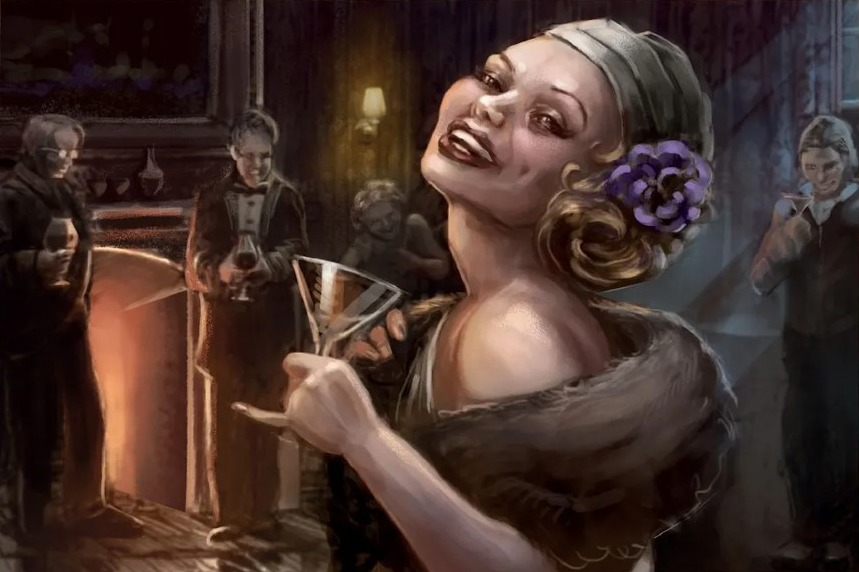

Первого сыщика, вошедшего в дверь, случайно задевает ногой по голени девушка, танцующая чарльстон. Она оборачивается и горячо извиняется. Если среди сыщиков нет мужчины с НАР 14 или выше, особого внимания она им не уделяет. *Прим. перев.:* в оригинале НАР 14. Для похожей ситуации с Глендой Барр на с. 12 указан порог НАР 55. Девушку зовут Ана Уошберн. Она знакома с Ариадной и мнит себя поэтессой. И Ариадна, и её вечеринки, по мнению Аны, «просто божественны».

Стол ломится от угощения, главным образом мясных нарезок и хлеба. Есть и большая кастрюля «настоящего венгерского гуляша», который приготовила горничная Фрида.

Молодого человека у фонографа зовут Бобби Хэмлин. Дорогой аппарат и столь же дорогие пластинки принёс он. Фонограф на самом деле принадлежит его семье, но Бобби им гордится и похвалится сыщикам: «В нём почти три ватта мощности!» Громче любого фонографа с ручным приводом, какой доводилось слышать сыщикам.

Бобби помешан на электронике и зачитывается статьями о новом приборе, телевизоре. «Их уже продают, — говорит он. — Осталось уговорить папу купить», — добавляет с ухмылкой. Он всерьёз подумывает бросить отцовское банковское дело, уехать в Нью-Йорк и попробовать устроиться на радио. Заниматься там «чем-нибудь», как он сам говорит.

### Кухня

Здесь прислуга готовит новые порции угощения под гортанные указания горничной Фриды. Дотти Харрис — одна из помощниц, студентка из университета. Она помогает готовить и подавать еду гостям. По тому, как она работает, легко заметить, что она чем-то расстроена.

Пока сыщики на кухне, дверь в подвал распахивается и появляется молодой человек с красными припухшими глазами. Снизу тянет сладковатым дымом. Дотти Харрис закатывает глаза. Юноша представляется Гордоном Чекли и спрашивает: «Не хотите поднабраться?» Он показывает маленький бумажный пакетик с сушёной зелёной травой. Согласившегося сыщика Чекли отведёт в подвал, где его ждёт приятель Юджин Уилкокс. Они раскуривают косяк и передают сыщику. Возможные эффекты приведены во врезке.

Молодой Уилкокс уже порядком накурился. Рядом виднеется пустой стакан из-под спиртного. Возможно, родители опасались не зря.

Уилкокс охотно поболтает, но стоит плохо отозваться о Варгах, как он мрачнеет.

— Вы прямо как мои родители, — говорит он заплетающимся языком. — Знаете, что бы я сделал, если бы узнал, что они мне врут? Пришлось бы их пристрелить. Точно.

Не дожидаясь ответа, он вынимает из кармана пиджака маленький никелированный дерринджер и беспечно им размахивает.

— Бах! — говорит он и смеётся…
