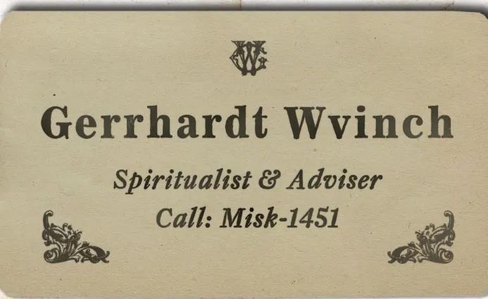

…и убирает пистолет обратно в пиджак. Чекли тоже смеётся и передаёт косяк.

Уилкокс останется в подвале с приятелем до удара гонга, который позже возвестит начало «Воззвания к Вакху». Сыщик, пообщавшийся с Уилкоксом, поймёт, что юноша без ума от графини.

> ### Действие марихуаны
>
> Марихуана относится к психоактивным веществам. Она обостряет восприятие, и курильщики лучше замечают детали (+10% к **Вниманию** и **Слуху**).
>
> Меняется и восприятие времени: час может показаться двумя или тремя. Краснеют глаза, речь становится невнятной, движения — неловкими. Чтобы определить дополнительный эффект, каждый игрок, чей персонаж курит, бросает 1d6.
>
> | 1d6 | Эффект |
> | --- | --- |
> | 1–2 | Начинает смеяться и с трудом может остановиться. |
> | 3 | Испытывает тревогу и беспокойство, хочет немедленно уйти с вечеринки и подышать свежим воздухом. |
> | 4 | Начинает без умолку болтать о чём угодно, потом теряет нить разговора. |
> | 5–6 | Внезапно, сам не зная почему, ужасно хочет есть и поднимается в столовую. |

### Оранжерея

Оранжерею пристроили к задней стене дома. У неё остеклённая стена и стеклянная крыша. Мужчина постарше что-то излагает двум молодым женщинам. Те слушают как заворожённые. Это Геррхардт Ввинч, профессиональный ясновидящий и медиум, друг Ариадны.

Ввинч рассказывает о спиритическом сеансе, который на днях провёл для этих двух девушек и Ариадны. Подойдя, сыщик услышит, как мужчина с сильным немецким акцентом говорит: «…поверьте, бояться нечего. Иногда случается то, чего мы не ждём». Заметив незнакомца, он обрывает рассказ. «Но мы попробуем в другой вечер. Уверен, в следующий раз выйдет лучше».

Ввинчу тридцать три года, родился он в Германии. В детстве он тяжело повредил голову и теперь утверждает, что может общаться с мёртвыми. Длинные серебристо-белые волосы он зачёсывает назад. Обычно одевается в чёрное.

— Добрый вечер, — говорит он, протягивая руку. — Геррхардт Ввинч, профессиональный спиритуалист, к вашим услугам. — Он слегка кланяется.

Ввинч действительно умеет говорить с мёртвыми. За сеанс берёт 20 долларов независимо от результата. Он с удовольствием перекинется с новым знакомым парой слов и даже даст визитку. Пока девушки не заскучали и не вернулись в дом, Ввинч рассказывает, как мальчишкой упал с дерева и сильно ушиб голову. *Прим. перев.:* фраза в оригинале грамматически обрывается на стыке оборотов Before и while.

— С тех пор, — говорит он, — я могу разговаривать с мёртвыми.

Проверка **Психологии** показывает, что Ввинч, по всему видно, сам верит в свои слова. Если сыщики бестактно спросят, о чём он говорил с девушками, Ввинч откажется вдаваться в подробности. Заговорят о графине — он поднимет бокал.

— За неё и за всех, кто на неё похож, — скажет он и осушит бокал. Потом извинится и отойдёт, объяснив, что пора бы подлить.

### Две девушки

Если сыщики догонят девушек, с которыми говорил Ввинч, те окажутся разговорчивее.

— Это было так странно! — говорит белокурая Лоррейн.

— Прямо как в кино, — подхватывает её подруга Лора.

Две недели назад Ариадна устроила вечер со спиритическим сеансом, который провёл Ввинч.

— Нас было всего шестеро, — говорит Лора.

— Мы сели кружком вокруг обеденного стола, — добавляет Лоррейн.

Всё это было ужасно весело, пока под конец Ариадна не попросила Геррхардта связаться с её покойной матерью в Венгрии.

— Сначала всё шло хорошо, — рассказывает Лора. — А потом Геррхардт зарычал и стал издавать жуткие звуки.

— Как будто подавился, — говорит Лоррейн.

*Прим. перев.:* в оригинале starting growling вместо started growling.

Тогда Ариадна закричала, свалилась со стула и попыталась забраться под стол. Что-то её ужасно напугало. Ввинч попробовал встать, но его вырвало, и он рухнул на колени.

— Золтан ужасно разозлился, — объясняет Лоррейн. — Он кричал на Геррхардта.

Через несколько минут оба пришли в себя, но вечер на том и закончился, все рано разошлись. *Прим. перев.:* в оригинале a manner of minutes вместо a matter of minutes.

— А жаль, — говорит Лоррейн. — Следующая была моя очередь. Хотела спросить у покойного дяди Рудольфа, где он спрятал миллион долларов. — Она смеётся и тычет подругу локтем в бок. Обе уходят, хихикая.

Сам того не понимая, Ввинч каким-то образом на миг связался с…

> **Раздатка доп. 2. Визитка Геррхардта Ввинча**
>
> Геррхардт Ввинч  
> Спиритуалист и советник  
> Тел.: Misk-1451
