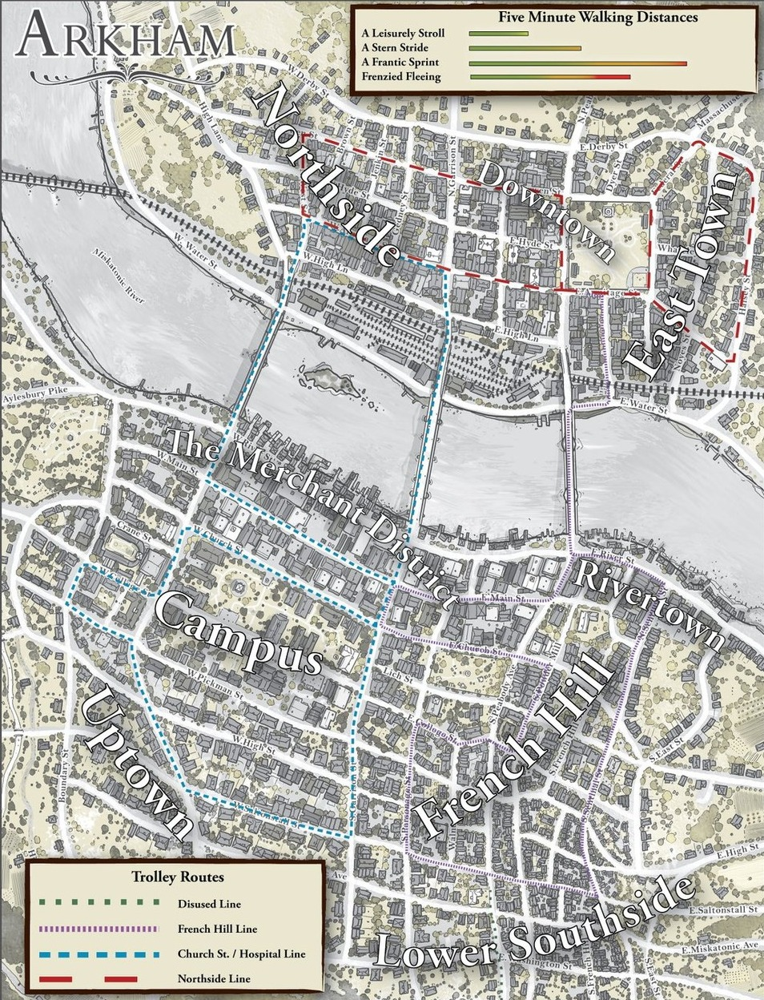

- **Районы:** Нортсайд, Даунтаун, Ист-Таун, Торговый район, Ривертаун, Кампус, Френч-Хилл, Аптаун, Нижний Саутсайд.
- **Расстояния за пять минут:** неспешная прогулка, решительный шаг, отчаянный спринт, бегство в панике.
- **Трамвайные маршруты:** зелёный — заброшенная линия, фиолетовый — линия Френч-Хилла, синий — линия Черч-стрит / больницы, красный — линия Нортсайда.

- Аркхэм. Река Мискатоник.
- Севернее реки: Хай-лейн, Браун-стрит, Дженкин-стрит, Гедни-стрит, Норт-Уэст-стрит, Норт-Гаррисон-стрит, Норт-Пибоди-авеню, Дайер-стрит, Федерал-стрит, Уотли-стрит, Нойес-стрит, Холси-стрит, Массачусетское шоссе.
- По обе стороны от Норт-Пибоди-авеню: Уэст- и Ист-Дерби-стрит, Уэст- и Ист-Карвен-стрит, Уэст- и Ист-Хайд-стрит, Уэст- и Ист-Армитидж-стрит, Уэст- и Ист-Хай-лейн, Уэст- и Ист-Уотер-стрит.
- Южнее реки: Эйлсберийская дорога, Крейн-стрит, Уэст-Пикман-стрит, Лич-стрит, Баундэри-стрит, Хилл-стрит, Уэст-стрит, Саут-Гаррисон-стрит, Саут-Парсонедж-стрит, Уолнат-стрит, Саут-Пибоди-авеню, Саут-Паудер-Милл-стрит, Саут-Френч-Хилл-стрит и Саут-Френч-Хилл, Норт- и Саут-Сентинел-стрит, Саут-Ист-стрит.
- Западные и восточные отрезки южных улиц: Ривер-стрит, Мейн-стрит, Черч-стрит, Колледж-стрит, Хай-стрит, Солтонстолл-стрит, Мискатоник-авеню и Вашингтон-стрит.
