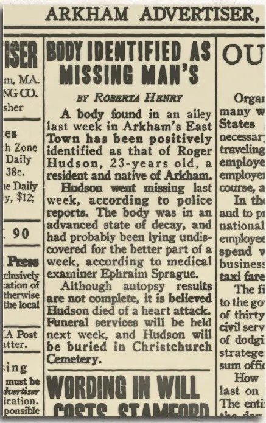

…чем-то набитый. Незнакомец протягивает руку, но Золтан отмахивается, встаёт, поворачивается к нему спиной и уходит.

Золтан проходит совсем рядом с сыщиком и бросает на него острый взгляд. Узнает ли он сыщика, зависит от того, встречались ли они прежде, насколько хороша маскировка и так далее. В любом случае Золтан заподозрит слежку и, если сыщик продолжит идти за ним, заговорит с ним в открытую. Снова перейдя на густой венгерский акцент, он отчита́ет сыщика и пообещает, что тот больше не попадёт ни на одну вечеринку в доме Варги. И сдержит слово: этого сыщика больше не впустят.

Если сыщик умудрится не вызвать подозрений, он сможет проследить за Золтаном до местного ресторана поприличнее, где тот поздно пообедает, а затем до вокзала, откуда Золтан вернётся в Аркхэм. Дома он сожжёт конверт вместе с содержимым в камине.

### Скользкий фотограф

Если сыщик пойдёт за незнакомцем, тот приведёт его к небольшому фотоателье. Хозяин, сорокалетний Хэл Партленд, отпирает дверь, заходит внутрь и переворачивает табличку стороной «Открыто» к улице.

В кармане у Хэла Партленда 2 000 долларов, а в подсобке полны́ шкафы запрещённой порнографии. Сыщика, который войдёт следом, он примет за обыкновенного клиента.

> **Раздатка 2. «Тело опознано как пропавший»**
>
> «АРКХЭМ АДВЕРТАЙЗЕР»  
> ТЕЛО ОПОЗНАНО КАК ПРОПАВШИЙ  
> Роберта Генри  
> Тело, найденное на прошлой неделе в переулке Ист-Тауна, точно опознано: это Роджер Хадсон, 23 лет, житель и уроженец Аркхэма. По данным полиции, Хадсон пропал на прошлой неделе. Тело было в далеко зашедшем состоянии разложения и, по словам судмедэксперта Эфраима Спрега, пролежало необнаруженным, вероятно, почти неделю. Хотя результаты вскрытия ещё не готовы, считается, что Хадсон умер от сердечного приступа. Похороны пройдут на следующей неделе; Хадсона похоронят на кладбище Крайстчерч.  

Сыщик может испробовать **Обаяние**, **Красноречие** и **Убеждение**, но Партленд ни за что не расскажет о сделке с человеком из парка или о подсобке, набитой порнографическими снимками, за которые грозит тюрьма. Сыщику придётся прибегнуть к проверке **Запугивания** с применением силы или к подкупу.

После хорошей взбучки или за 50 долларов Партленд назовёт Девона Маккоя. «Он мошенник», — скажет фотограф. Чтобы он признался, что вымогал у старика деньги, понадобится взбучка посерьёзнее или хотя бы 100 долларов.

— Несколько лет назад его подружка попросила сделать для журнала несколько её снимков. А теперь, видать, захотела получить их обратно.

Если спросить, что за журнал, Партленд ответит: «Особые журналы. Ну, вы понимаете. Для джентльменов». Он может назвать имя женщины — Ариадна Мэдден.

### Пятница

Позавтракав, Золтан возвращается домой и весь день готовится к вечерней вечеринке.

## Другие сведения из Бостона

Если у сыщика есть время и нужные связи, можно узнать о Девоне Маккое больше. Целый день в архиве «Boston Globe» и успешная проверка **Работы в библиотеке** позволят найти его имя в заметке 1922 года о финансовой пирамиде, которую раскрыли бостонские детективы. Некто Девон Маккой был осуждён за пособничество и получил год тюрьмы. Через знакомых в бостонской полиции, старых или новых, сыщик узнает то же самое. Полицейские добавят, что Маккоя за эти годы ещё несколько раз арестовывали, но в газеты это не попало. На женщину по имени Ариадна Мэдден поступало несколько жалоб, но её ни разу не арестовывали. Последние известные адреса обоих двухлетней давности, толку от них, по мнению полиции, уже нет. Впрочем, последним Ариадна указала дом своего детства в бостонском Саут-Энде.

### Дом Мэдденов

По адресу стоит скромный дом в сплошном ряду таких же домов. Деннис Мэдден, отец Ариадны, дома: он вышел на пенсию в начале года. На нём грязная майка без рукавов, на лице трёхдневная щетина. С густым бостонским выговором он заявляет сыщикам:

— Нечего мне вам сказать ни про дочку, ни про что ещё.

Он не видел её лет пять.

— У меня ещё две дочки, вот они порядочные. А эта пусть катится к чёрту. Мне всё равно.
