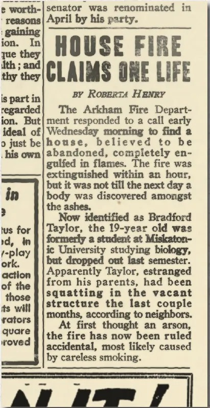

## Слежка за Ариадной

Ариадна спит дольше Золтана и редко выходит из дома раньше десяти утра. Сначала Фрида готовит ей завтрак. Ариадна менее осторожна, так что следить за ней проще. И всё же, как и с Золтаном, сыщикам стоит меняться день ото дня.

> **Раздатка 3. «Пожар унёс жизнь»**
>
> ПОЖАР УНЁС ЖИЗНЬ  
> Роберта Генри  
> Рано утром в среду пожарная команда Аркхэма выехала по вызову и нашла дом, считавшийся заброшенным, целиком охваченным пламенем. Огонь потушили за час, но лишь на следующий день на пепелище нашли тело.  
> Теперь его опознали: это 19-летний Брэдфорд Тейлор, бывший студент-биолог Мискатоникского университета, бросивший учёбу в прошлом семестре. По словам соседей, Тейлор, поссорившийся с родителями, последние пару месяцев самовольно жил в пустующем доме.  
> Сначала пожар сочли поджогом, но теперь признали случайным: вероятнее всего, причина — неосторожное курение.  

### Суббота

Золтан и Ариадна весь день дома, видимо, убирают после вчерашней вечеринки. Около 13:00 Фрида выходит и выбрасывает в мусорный бак свёрток окровавленных простыней.

### Воскресенье

Ариадна идёт в церковь Святого Станислава вместе с Золтаном. После обеда в Нижнем Саутсайде они возвращаются около 15:00 и проводят остаток дня дома.

### Понедельник

Понедельник — день покупок. Сперва Ариадна заглядывает в магазин «Вулворт» на Черч-стрит в Торговом районе. Проводит там час-другой, покупает пару безделушек для спальни, потом обедает у стойки с газировкой. Берёт сэндвич с яичным салатом, картофельные чипсы и лимонную кока-колу.

Остаток дня она бродит по магазинам Торгового района. То тут, то там покупает по мелочи и болтает с хозяевами с густым венгерским акцентом. Большинство торговцев её хорошо знают. Тратит она обычно немного, зато покупки делает регулярно. Непременно берёт свежие выпуски «Boxoffice» и «Photoplay», двух ежемесячных журналов для любителей кино.

Около 16:00 она возвращается и проводит вечер дома с дядей Золтаном.

### Вторник

Ариадна остаётся дома до полудня. Около 12:30 она берёт такси до Френч-Хилла и просит водителя подождать, пока она зайдёт в цветочный магазин Олмена. Через несколько минут она выходит с двумя завёрнутыми букетами и снова садится в машину.

Такси едет в Нижний Саутсайд и высаживает Ариадну у входа на кладбище Крайстчерч. Ворота открыты, дальше она идёт пешком.

На кладбище сегодня есть посетители, и на ещё одного незнакомца Ариадна особого внимания не обратит. Сыщик, идущий за ней, видит, как она останавливается у довольно свежей могилы, опускается на колени, крестится и кладёт букет у надгробия. Поднявшись, несколько минут стоит со склонённой головой, точно молится про себя, затем уходит. Через несколько минут, метрах в ста, она находит вторую могилу и повторяет всё сначала. Эта могила тоже недавняя. Затем она возвращается к главным воротам, вызывает такси из ближайшей лавки и едет домой. На сегодня выходов больше не будет.

Если сыщик проверит надгробия, то прочтёт: Брэдфорд Тейлор, девятнадцать лет, умер две недели назад, и Роджер Хадсон, двадцать три года, умер около четырёх недель назад.

### Среда

Ариадна отправляется делать причёску и маникюр в салон красоты мисс Дженни в Торговом районе. Это занимает четыре часа. Потом она ещё пару часов ходит по магазинам и возвращается домой.

### Четверг

Ариадна весь день дома, а Фрида уходит за покупками к завтрашней вечеринке. В дом приходят двое джентльменов. Оба оставляют машины за квартал или два и идут пешком. Первый приходит незадолго до полудня и проводит в доме около часа. Второй появляется около 13:30. Сыщики не увидят, как он уйдёт. Фрида возвращается примерно в 15:30.

Вечером Ариадна и Золтан вместе разжигают камин.

### Пятница

Весь день дома, скорее всего, готовится к вечернему торжеству.

## Две могилы

Сыщикам нетрудно будет сопоставить имена с недавними происшествиями. Немного поисков в «Аркхэм Адвертайзер» — и найдутся две свежие заметки. См. раздатки «Шальная полночь» 2 и 3.
