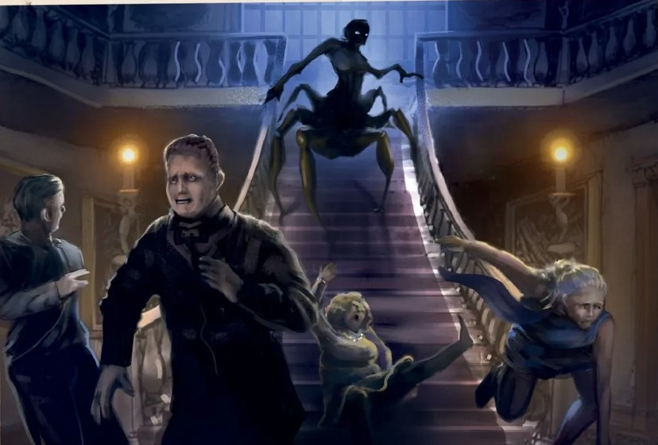

Поначалу дела шли неплохо. По его словам, желаемого контакта удавалось добиться хотя бы на одном сеансе из четырёх, и большинство клиентов рано или поздно оставались довольны. Но время шло, деньги были нужны всё сильнее, а дар, казалось, слабел. Вскоре Ввинчу пришлось изображать контакт с духами. Он задавал клиентам наводящие вопросы и подхватывал ответы, чтобы представление звучало убедительно. Он даже завёл пару механических приспособлений, чтобы издавать звуки в квартире и «сгущать атмосферу». Перед злополучным сеансом в доме Варги две недели назад Геррхардт больше года не мог связаться ни с одним духом и боялся, что навсегда лишился дара. Теперь, хоть он и боится духа, который вселился в него в тот вечер, ему почти не терпится попробовать снова. Вдруг способности возвращаются?

Геррхардт согласится провести сеанс с сыщиками, но будет настаивать, чтобы он прошёл у одного из них дома. Ему ни к чему любопытные чужаки в квартире, где они могут раскрыть его уловку. В крайнем случае Ввинч предложит снять на вечер гостиничный номер.

## Последний вальс

В эту пятницу вечеринка куда тише обычного, гостей, пожалуй, вполовину меньше. Одни не пришли из уважения к юноше, который на прошлой неделе покончил с собой. Другие держатся подальше, потому что всё сильнее пахнет публичным скандалом.

Золтан хотел отменить вечеринку. У них с Ариадной билеты на поезд из Аркхэма завтра, вскоре после полудня. После самоубийства на прошлой неделе он не видит нужды привлекать к себе лишнее внимание. Но Ариадна настояла. Раз это её последний вечер в городе, нужно непременно устроить ещё один приём. Её «друзья и поклонники» разочаруются, если она этого не сделает. В конце концов Золтан уступил.

Эрик Лутгарт снова за роялем в гостиной, но играет в основном тихо. Он берётся за популярную мелодию, однако почти никто не подпевает. Тогда Эрик переходит к ноктюрну Шопена. Стюарт Портман, высокомерный как всегда, всё же пришёл и держится возле бара.

Библиотека почти пуста: там только одна пара. В оранжерее за ней никого.

В малой гостиной несколько человек тихо беседуют. За карточным столиком пусто.

Шумная компания в столовой почти та же, что на прошлой неделе, и, похоже, ничуть не смущена. Молодой человек снова принёс фонограф, а танцоры бодры, как всегда.

На кухне работают двое студентов, а Фрида обходит дом, разнося угощение. Чекли в подвале передаёт косяк паре новых приятелей.

