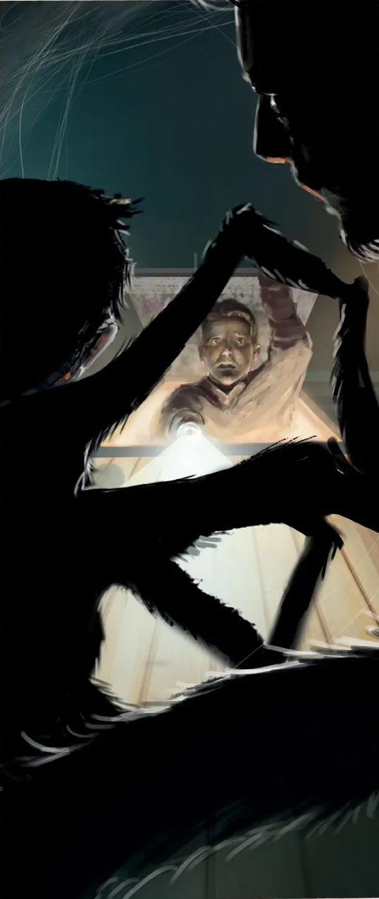

### Золтан и Ариадна

Хозяин и хозяйка ходят по дому, временами останавливаясь поболтать с гостями. Ариадна оживлена, говорит громко и, пожалуй, ещё общительнее обычного. Золтан сдержан, даже угрюм. Он, похоже, не спускает с неё глаз, а она всеми силами его избегает. Стоит ему появиться, как Ариадна находит повод выйти из комнаты.

### Ссора

Наконец в гостиной Золтан настигает Ариадну. Загнав её в угол, он наклоняется, хватает её за руку и что-то шепчет на ухо. Вид у него сердитый.

Ариадна слушает, глаза у неё всё шире. Вдруг она огрызается:

— С меня хватит. Оставь меня в покое!

Она вырывается и стремительно выходит из комнаты. Протискивается мимо Портмана, сворачивает в прихожую и поднимается по лестнице. Золтан идёт за ней по пятам.

— Постой! — кричит он, но она и ухом не ведёт.

Пока Золтан поднимается, дверь спальни Ариадны с треском захлопывается. На шум в прихожую выходит встревоженная Фрида. Она встаёт на нижнюю ступеньку и, если кто-нибудь из гостей попытается пойти следом за парой, без слов преградит ему дорогу жестами.

Золтан входит в спальню Ариадны и хлопает дверью за собой. Даже внизу отчётливо слышны крики и обвинения. Потом какой-то шум, и вдруг сдавленный крик. Мужской.

Фрида тревожно смотрит наверх. Если никто из сыщиков не сделает первый шаг, она взбегает по ступенькам и направляется в спальню Ариадны. Миг спустя раздаётся вопль, и Фрида несётся вниз по лестнице, крича во всё горло:

— Боже мой! Она убила его! Она всех нас убьёт!

Горничная пробивается сквозь толпу, вылетает в парадную дверь и исчезает в ночи. В конце концов Фрида доберётся до Бостона. В Аркхэме её больше не увидят.

