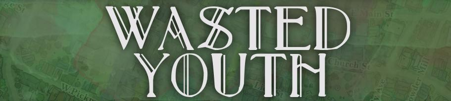

# Загубленная юность

Для этого сценария достаточно небольшой группы сыщиков. Персонажи могут быть любых профессий. В развязке от них потребуется больше физической выносливости, чем во многих других сценариях. У тех, кто привык жить и действовать на природе, будет случай отличиться.

Жёсткого расписания у сценария нет. По замыслу сыщики вступают в дело в первых числах июня, сразу после начала летних каникул. Точный день и дату выбирает Хранитель.

## Сведения для Хранителя

В XX веке большая часть Соединённых Штатов переживает огромные перемены. Промышленность продолжает менять общество, и для её работы нужны люди и из ближних, и из дальних краёв. Новые товары обещают облегчить жизнь. Сельский уклад, господствовавший почти всю историю человечества, постепенно уступает место жизни в тесных, многолюдных городах. Конечно, перемены даются нелегко. Стоит собрать на тесном пятачке множество людей, выросших в разных культурах, и разве удивительно, что между ними возникают трения? И тревогу вызывают далеко не одни «чужаки». Современность расшатывает сам семейный уклад, а старшие поколения пытаются найти себе место в новом мире. А что молодые? Они тоже на распутье. Возможно, дети понимают меньше взрослых, зато перемены могут оставить в их жизни куда более глубокий след.

Даже сонный университетский Аркхэм испытывает на себе это напряжение. В последние недели участились случаи детской преступности, особенно среди учеников младших и средних классов. На этот раз причина кроется в тёмном прошлом долины реки Мискатоник, хотя утешения в том мало.

Семья Кори тоже пытается приспособиться к современной жизни. Они держали ферму в Данвиче, но продали её и со всем своим скарбом переехали в новый дом в Аркхэме. Им казалось, что здесь их единственному ребёнку, маленькому Элайдже, будет лучше расти в более современной обстановке.

Элайдже оказалось трудно привыкнуть к городу. С соседскими детьми он так и не подружился, а одноклассники считают его деревенщиной. По натуре он одиночка. В Данвиче он подолгу бродил по лесам и полям, собирая интересных насекомых и камешки. Однажды ему попалась странная чёрная слизь.

### Гиперборейский след

Тысячелетия назад в ту часть Массачусетса, где ныне стоит Данвич, прибыли поселенцы из доисторической Гипербореи. Они построили город и поначалу процветали, возводя величественные храмы своим многочисленным богам. Величайшим из них был Жотаккуа, мохнатая жаба с чертами летучей мыши, которая, по преданию, обитала где-то под землёй. Верховный жрец культа Жотаккуа, колдун по имени Урив Залотос, был глубоким стариком и чувствовал, что конец близок. Отчаянно цепляясь за жизнь, он придумал выход.

Принеся в жертву нескольких стражей храма, бесформенных отродий своего бога, Залотос сумел извлечь из их податливых тел эссенцию. Она могла принять и уберечь его дух, когда смертное тело умрёт и истлеет. На пороге смерти Залотос перенёс дух в чёрную субстанцию, а его прислужники спрятали её в подземной камере под храмом.

На этом дело не заканчивалось. Чтобы Залотос смог восстать, жрецам Жотаккуа предстояло ещё несколько лет совершать особые обряды, в том числе приносить в кровавую жертву гиперборейских детей.

Но прежде, чем они успели завершить обряды, некогда цветущая колония внезапно распалась. Гиперборейцы разбрелись по диким краям, храмы обратились в руины, а дух Залотоса остался в плену у смолистой слизи, спрятанной в подвале храма.

Однако Залотос обладал могучей волей и сдаваться не собирался. Понадобились столетия, чтобы слизь понемногу просочилась сквозь развалины и наконец выбралась на поверхность.

### Залотос в Данвиче

Не прошло и года, как на почти неподвижную лужицу слизи случайно наткнулся любознательный фермерский мальчишка Элайджа Кори. Он собрал чёрную жижу в банку Мейсона, которую всегда носил с собой, и сам того не ведая принёс домой колдуна-мертвеца.

*Прим. перев.:* В оригинале здесь напечатано «Elijay Corey» вместо «Elijah Corey».
