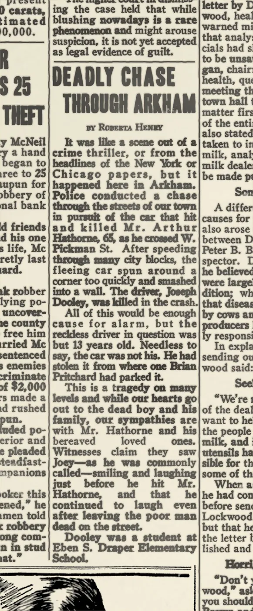

> **Раздатка 1. «Смертельная погоня по Аркхэму»**
>
> СМЕРТЕЛЬНАЯ ПОГОНЯ ПО АРКХЭМУ
>
> Роберта Генри
>
> Как в криминальном романе или заголовках нью-йоркских и чикагских газет — но случилось это здесь, в Аркхэме. Полиция гналась по улицам нашего города за машиной, которая сбила насмерть 65-летнего мистера Артура Хаторна, переходившего Уэст-Пикман-стрит. Промчавшись через много кварталов, беглая машина слишком быстро свернула за угол, её развернуло, и она врезалась в стену. Водитель, Джозеф Дули, погиб в аварии.
>
> Одного этого хватило бы для тревоги, но безрассудному водителю было всего 13 лет. Нечего и говорить, что машина была не его: он угнал её оттуда, где её оставил некий Брайан Притчард.
>
> Это трагедия во многих отношениях, и, хотя мы сочувствуем погибшему мальчику и его семье, наши соболезнования — мистеру Хаторну и его скорбящим близким. Свидетели утверждают, что видели, как Джоуи — так его обычно звали — улыбался и смеялся прямо перед тем, как сбить мистера Хаторна, и продолжал смеяться, оставив несчастного мёртвым на мостовой.
>
> Дули учился в начальной школе имени Эбена С. Дрейпера.

Вскоре жрец заговорил с Элайджей. Его шёпот слышал только мальчик, и голос соблазнял его обещаниями. Несколько месяцев назад, вскоре после переезда семьи в Аркхэм, Залотос хитростью заставил Элайджу проглотить кусочек чёрной субстанции. С тех пор злобный дух Залотоса получил настоящую власть над мальчиком, и с каждым днём она растёт.

Чтобы завершить обряды и возродиться в новом, более могущественном обличье, Залотосу требовалось принести в жертву ещё детей. Недавно жрец заставил Элайджу подмешивать субстанцию в еду других ребят, начав с одноклассников и соседей. Замысел провалился. Заражённые дети вышли из-под контроля, крушили всё вокруг, а некоторые и сами погибли. Теперь у Залотоса новый план. Во время загородного похода мальчик подмешает слизь в еду товарищам-бойскаутам. На этот раз всё получится благодаря нужному заклинанию. Затем Залотос заставит Элайджу повести мальчиков через леса и поля к развалинам храма, где тот совершит жертвоприношения и обряды, необходимые для его возрождения.

### Чёрная слизь

В этой густой, смолистой массе, извлечённой из принесённых в жертву отродий Цатхоггуа, обитает разумная душа гиперборейского колдуна Залотоса. Субстанция не переваривается, но выделяет токсины. Они разносятся по телу жертвы и со временем достигают мозга, где могут повредить его ткани.

Когда Залотос уговорил Элайджу съесть кусочек чёрной слизи, он перенёс в мальчика большую часть своего сознания и стал постепенно подчинять его разум. Чтобы добыть детей для жертвоприношений, необходимых для возрождения, Залотос заставил Элайджу тайком подмешать субстанцию в еду нескольким школьным товарищам, а также в кекс, которым тот угостил старшего мальчика по соседству, Лу Марино.

В этих кусочках были лишь следы сущности Залотоса, и опыт закончился неудачей. Спустя десять дней инкубационного периода у жертв начал меняться характер, а в течение двух недель каждый из них устроил буйную выходку.

У Залотоса новый план. В походе бойскаутов он заставит Элайджу тайком подмешать остатки субстанции в еду скаутам. После трапезы Залотос в теле Элайджи предложит мальчикам исполнить якобы индейский обряд. На самом деле это гиперборейское заклинание, которое подчинит остальных скаутов Элайдже и заставит исполнять его приказы.

## Сведения для сыщиков

Выдайте игрокам раздатки «Загубленная юность» 1, 2 и 3. Это заметки «Аркхэм Адвертайзер» за последний месяц.

Если среди сыщиков есть журналисты или люди, интересующиеся психиатрией либо социологией, этой серии заметок может хватить, чтобы они взялись за расследование. Если у сыщиков уже есть связи в аркхэмской полиции, в органах власти или даже в морге, их могут пригласить в качестве консультантов.

Родители одного из пострадавших детей могут оказаться знакомыми сыщиков или друзьями их друзей. Они могут предложить деньги за помощь в расследовании, особенно если сыщики занимаются подобными делами профессионально.
