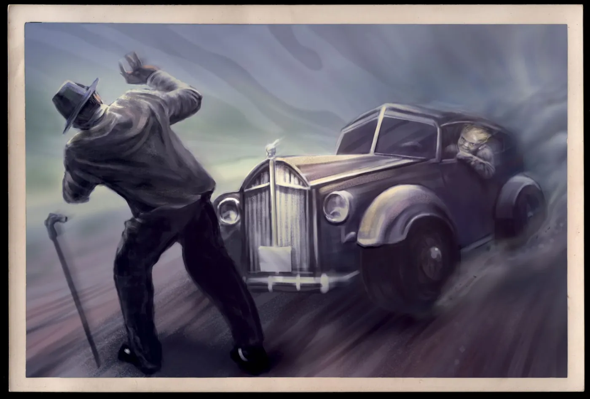

Хороший выбор для Хранителя — Сара Рид. Она единственная из детей Аркхэма, кто всё ещё заражён.

Сыщики могут узнать о беде и на собственном опыте. Возможно, они станут свидетелями одного из происшествий, о которых пишут в газетах. Сара Рид может улизнуть из дома и устроить одному из сыщиков неприятность, например повредить машину, или сделать с ним что похуже. С этого и начнётся сценарий.

## Расследование в Аркхэме

Проверяя газетные сообщения, сыщики могут обратиться в полицию Аркхэма, к репортёрам «Аркхэм Адвертайзер», в Аркхэмскую психбольницу и в морг. Хранителю следует скорректировать описание этих мест с учётом прежних отношений сыщиков с этими учреждениями, удачных или скверных.

Далее описаны семьи, которых коснулся недавний всплеск детской преступности. У расследования много направлений, и предугадать, куда отправится конкретная группа, трудно. Хранителю придётся решать по обстоятельствам, где и когда сыщики найдут ключевую улику.

Успешное расследование приводит сыщиков в дом Элайджи Кори, где они узнают, что мальчик уехал из города в поход с бойскаутами. Так начинается вторая часть сценария — переход через глушь Массачусетса и, скорее всего, решающая схватка к востоку от Данвича.

### «Аркхэм Адвертайзер»

За последний месяц в газете вышли три заметки. Две написала ведущая сотрудница редакции Роберта Генри, а вторую по счёту — внештатный репортёр Флойд Тоби. Если сыщики прежде не имели дела с Робертой, она отмахнётся от них, сказав, что ничего больше не знает. Успешная проверка Психологии подскажет, что она, вероятно, знает больше, но не хочет делиться. Роберта до сих пор злится, что во время второго происшествия была за городом и материал, который должен был достаться ей, отдали Тоби.

С Флойдом Тоби совсем другая история. Ему лет тридцать пять, он невысокий, полноватый и начинает лысеть. Он приветлив и охотно разговаривает. Жаль только, что толком он ничего не знает. Сыщики могут заподозрить это уже через несколько минут разговора. Однако Тоби перескажет один любопытный слух. По словам его источников, судмедэксперт Аркхэма обнаружил в теле Лу Марино, мальчика, умершего на улице от сердечного приступа, какое-то неизвестное инородное вещество. Тоби доверчив, но строго блюдёт журналистскую этику и адрес Марино не выдаёт.
