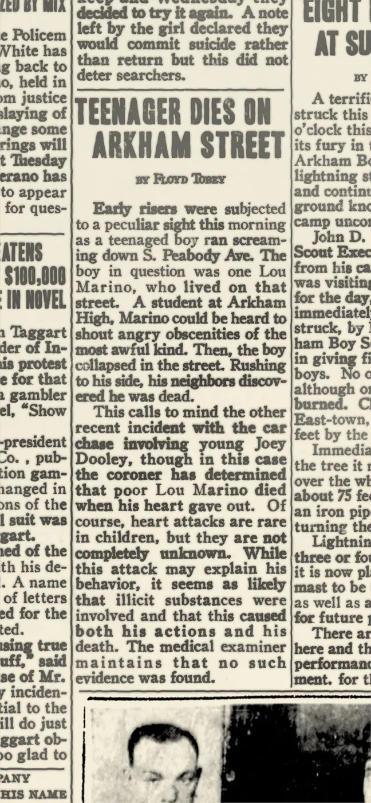

### Полиция Аркхэма

Если у сыщиков нет друзей или знакомых в управлении полиции, от этого визита будет мало толку. Всё это «служебное дело полиции», и ни патрульные, ни детективы обсуждать его не хотят.

Даже при хороших связях сыщики узнают мало ценного. «Нынешним детям дома делать нечего, никаких обязанностей. Вот они по улицам и шатаются. А потом попадают в беду».

Даже хороший знакомый в управлении неохотно выдаст адреса детей. Может потребоваться проверка Обаяния или Убеждения, а скорее всего, придётся прийти ещё раз и настоять на своём, когда у сыщиков будет больше улик.

#### Начальник полиции Эйса Николс

Если у сыщиков хорошие отношения с начальником полиции, они могут поговорить напрямую с Эйсой Николсом. Члены Ротари-клуба или масонской ложи могут попробовать устроить встречу через эти связи.

Николс, разумеется, обеспокоен недавними событиями, но не знает, как быть. В последнее время он чувствует на себе груз всех своих шестидесяти одного года и не скрывает растерянности. Он порядочный человек, которому кажется, что мир меняется быстрее, чем он успевает за ним угнаться.

«Знаете, бывает у нас морока с ребятами постарше из семей иммигрантов. Ирландские, итальянские подростки, заняться им нечем. Тут я ещё могу что-то понять. Но эти-то мальчишки совсем маленькие… Некоторые даже из приличных семей. Нам теперь и с этим разбираться?»

Николс может сказать, что никто из этих детей прежде с полицией дела не имел.

Если спросить, не могло ли такое поведение быть следствием болезни, Николс ответит, что доказательств этому нет. Если сыщики продолжат настаивать, он предостережёт их, что от таких безосновательных догадок вреда выйдет больше, чем пользы. Проблема, по его мнению, общественная. Паника среди горожан делу не поможет.

### Морг Аркхэма

Морг Аркхэма находится в подвале больницы Святой Марии на Уэст-стрит. Обоих погибших мальчиков давно похоронили, но протоколы вскрытия хранятся здесь.

При первом визите сыщики не застанут судмедэксперта Аркхэма, доктора Эфраима Спрега. Служитель морга Роберт Дент не даст им просмотреть протоколы. Дент хорошо знает своё дело, и Обаяние, Красноречие, Запугивание и Убеждение на него не действуют.

> **Раздатка 2. «Подросток умер на улице Аркхэма»**
>
> ПОДРОСТОК УМЕР НА УЛИЦЕ АРКХЭМА
>
> Флойд Тоби
>
> Ранние прохожие стали сегодня утром свидетелями странного зрелища: по Саут-Пибоди-авеню с криками бежал подросток. Это был Лу Марино, живший на этой улице. Было слышно, как ученик Аркхэмской средней школы выкрикивает злобные непристойности самого ужасного свойства. Потом мальчик рухнул на мостовую. Бросившиеся к нему соседи обнаружили, что он мёртв.
>
> Это напоминает недавний случай с погоней, в которой участвовал юный Джоуи Дули, хотя здесь коронер установил, что бедняга Лу Марино умер оттого, что не выдержало сердце. Разумеется, сердечные приступы у детей редки, но не так уж неслыханны. Хотя приступ мог бы объяснить его поведение, не менее вероятно, что тут замешаны запрещённые вещества, ставшие причиной и его поступков, и его смерти. Судмедэксперт утверждает, что никаких следов таковых не найдено.

Зато Дент берёт взятки. За 10 долларов он принесёт оба протокола и даст сыщикам несколько минут на ознакомление.

Если сыщики уйдут, не прочитав протоколы, и придут в другой раз, они застанут в морге доктора Спрега. Он покажет протоколы только хорошим знакомым либо сыщикам, успешно прошедшим проверку Обаяния или Убеждения. Впрочем, он признается, что нашёл в желудках обоих мальчиков странное вещество. Если это какой-то запрещённый наркотик, Спрег с таким ещё не сталкивался. «Смолистая чёрная жижа», — говорит он. К сожалению, оба образца он выбросил.
