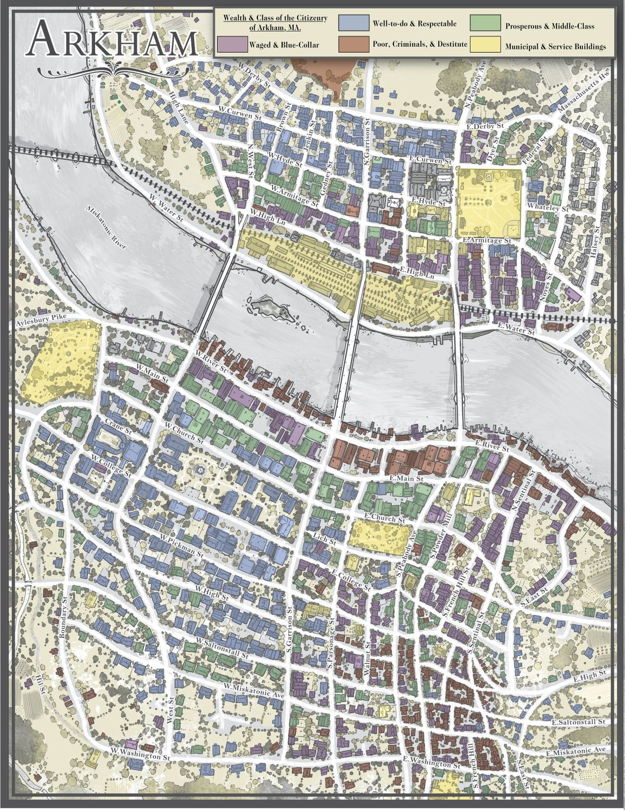

### Аркхэм: достаток и сословия жителей

- Серо-синим — состоятельные и почтенные.
- Зелёным — зажиточные и средний класс.
- Лиловым — наёмные и рабочие.
- Коричневым — бедняки, преступники и нищие.
- Жёлтым — городские и служебные здания.

**Подписи на карте**

- Аркхэм, Массачусетс (Arkham, MA).
- река Мискатоник (Miskatonic River).
- Эйлсберийская дорога (Aylesbury Pike).
- Массачусетское шоссе (Massachusetts Highway).
- Хай-лейн (High Lane).
- Уэст-Дерби-стрит (W. Derby St.).
- Ист-Дерби-стрит (E. Derby St.).
- Уэст-Карвен-стрит (W. Curwen St.).
- Ист-Карвен-стрит (E. Curwen St.).
- Браун-стрит (Brown St.).
- Дженкин-стрит (Jenkin St.).
- Гедни-стрит (Gedney St.).
- Норт-Гаррисон-стрит (N. Garrison St.).
- Норт-Пибоди-авеню (N. Peabody Ave.).
- Норт-Уэст-стрит (N. West St.).
- Дайер-стрит (Dyer St.).
- Федерал-стрит (Federal St.).
- Уотли-стрит (Whateley St.).
- Холси-стрит (Halsey St.).
- Нойес-стрит (Noyes St.).
- Уэст-Хайд-стрит (W. Hyde St.).
- Ист-Хайд-стрит (E. Hyde St.).
- Уэст-Армитедж-стрит (W. Armitage St.).
- Ист-Армитедж-стрит (E. Armitage St.).
- Уэст-Хай-лейн (W. High Ln.).
- Ист-Хай-лейн (E. High Ln.).
- Уэст-Уотер-стрит (W. Water St.).
- Ист-Уотер-стрит (E. Water St.).
- Уэст-Ривер-стрит (W. River St.).
- Ист-Ривер-стрит (E. River St.).
- Уэст-Мейн-стрит (W. Main St.).
- Ист-Мейн-стрит (E. Main St.).
- Крейн-стрит (Crane St.).
- Уэст-Черч-стрит (W. Church St.).
- Ист-Черч-стрит (E. Church St.).
- Уэст-Колледж-стрит (W. College St.).
- Ист-Колледж-стрит (E. College St.).
- Лич-стрит (Lich St.).
- Уэст-Пикман-стрит (W. Pickman St.).
- Уэст-Хай-стрит (W. High St.).
- Ист-Хай-стрит (E. High St.).
- Саут-Пибоди-авеню (S. Peabody Ave.).
- Саут-Паудер-Милл-стрит (S. Powder Mill).
- Саут-Френч-Хилл-стрит (S. French Hill St.).
- Норт-Сентинел-стрит (N. Sentinal St.).
- Саут-Сентинел-стрит (S. Sentinal St.).
- Саут-Ист-стрит (S. East St.).
- Баундари-стрит (Boundary St.).
- Хилл-стрит (Hill St.).
- Уэст-стрит (West St.).
- Саут-Гаррисон-стрит (S. Garrison St.).
- Саут-Парсонедж-стрит (S. Parsonage St.).
- Уолнат-стрит (Walnut St.).
- Уэст-Солтонстолл-стрит (W. Saltonstall St.).
- Ист-Солтонстолл-стрит (E. Saltonstall St.).
- Уэст-Мискатоник-авеню (W. Miskatonic Ave.).
- Ист-Мискатоник-авеню (E. Miskatonic Ave.).
- Уэст-Вашингтон-стрит (W. Washington St.).
- Ист-Вашингтон-стрит (E. Washington St.).
